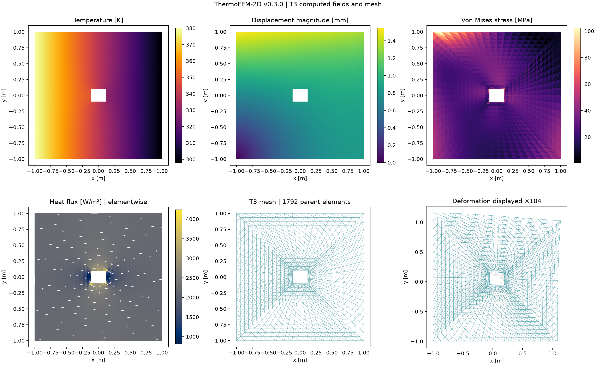

# ThermoFEM-2D

[](https://github.com/MehdiSoroush/thermofem2d/actions/workflows/ci.yml)

**Parametric finite element analysis of a perforated plate under thermal loading**

> **v0.5.0 — independent Q4 spatial cross-check, November 2026.** In addition to the sequential T3/T6 solver, the software includes **newly implemented two-way transient linear plane-stress thermoelasticity** with mechanical inertia and strain-rate thermal feedback. The original 2016 MATLAB numerical results have **not** been independently reproduced.



## Overview

ThermoFEM-2D is a small, auditable Python finite-element research application. The source study was a **summer 1395 (2016) MATLAB coursework project**, concerned with classical coupled thermoelasticity of a square perforated plate using six-node quadratic triangular elements and three nodal unknowns (`u_x`, `u_y`, `theta`). The archival Persian-language manuscript is not distributed here.

**The 2026 Python solver is an independently implemented continuation of the 2016 coursework.** Version 0.2 introduced verified straight-sided T6 elements; v0.3 added **dynamic mechanical inertia and two-way thermoelastic coupling**; v0.4 added **independent-in-time reference integration and energy-budget checks** for both T3 and T6; v0.5 adds an **independently assembled Q4 quadrilateral reference** for spatial comparisons, including explicit evidence of unresolved disagreement. The new plane-stress numerical method has been tested against algebraic and analytical limiting cases, but it is **not** a literal reconstruction of the incomplete historical matrices or results. See [coupled dynamics](docs/COUPLED_DYNAMICS.md), [source audit](docs/SOURCE_AUDIT.md), and [formulation](docs/FORMULATION.md).

## Current capabilities

- Rectangular plate with one **movable and resizable rectangular through-hole** (geometry-fitted mesh; all coordinates in metres).
- Selectable **three-node linear (T3)** and **six-node quadratic (T6)** triangular elements, with shared midside nodes, consistent quadratic edge loads, and sparse global assembly and correct element orientation.
- **Steady-state** isotropic Fourier heat conduction and **transient** conduction using a consistent heat capacity matrix and implicit backward Euler.
- **Monolithic fully coupled linear transient plane-stress thermoelasticity:** consistent structural mass, reciprocal thermal expansion and strain-rate feedback matrices, and Newmark/backward-Euler integration for T3 and T6.
- Prescribed temperatures on named boundaries; constant imposed inward heat flux and uniform volumetric heat sources.
- Linear, small-strain **plane-stress** elasticity with thermal-expansion loads and optional constant mechanical tractions.
- Separately prescribed `ux` and `uy` on named boundaries with incompatible thermal corner values rejected.
- Temperature, displacement magnitude, and **element-centroid** von Mises stress contour plots; **element-centroid Fourier heat-flux maps**, deformed-mesh visualization with a stated magnification factor, mesh inspection, CSV + JSON results.
- Optional interactive Streamlit interface (geometry sliders and interactive parameter configuration).
- Reproducible analytical checks, high-accuracy independent **temporal** reference integration, a **separate Q4 reference FEM** for spatial cross-checks (not an application-selectable element yet), linearized thermoelastic energy-budget diagnostics, mesh/time-step sensitivity studies, and GitHub Actions tests.

## Quick start

Requires Python 3.11+.

```bash
python -m venv .venv
# Windows PowerShell: .venv\Scripts\Activate.ps1
# Linux/macOS: source .venv/bin/activate
python -m pip install -e ".[dev]"
python -m pytest -q
python -m thermofem2d.cli --config examples/steady_plate.json --out results
python -m thermofem2d.cli --config examples/offset_hole_transient.json --out results-offset
python -m thermofem2d.cli --config examples/steady_plate_t6.json --out results-t6
python -m thermofem2d.cli --config examples/coupled_plate_t6.json --out results-coupled
python examples/scripts/mesh_study.py
python examples/scripts/verify_manufactured.py
python examples/scripts/compare_elements.py
python examples/scripts/verify_coupled_convergence.py
python examples/scripts/verify_q4_spatial.py
```

Optional graphical interface:

```bash
python -m pip install -e ".[app]"
streamlit run app.py
```

**The Streamlit UI is an optional convenience, not the verification baseline.** The command-line solver and tests do not depend on Streamlit. UI smoke tests run on GitHub Actions; the optional Streamlit dependency is not installed in the present local environment.

## Change the geometry and boundary conditions

All inputs are in JSON files in `examples/`:

```json
{
  "geometry": {"width": 2.0, "height": 2.0,
               "hole_width": 0.24, "hole_height": 0.20,
               "hole_cx": 0.0, "hole_cy": 0.0,
               "per_side": 16, "radial": 14, "element_type": "T6"}
}
```

Move the hole by changing `hole_cx` and `hole_cy`, resize it with `hole_width` and `hole_height`, refine the mesh with `per_side` and `radial`, and select `"element_type": "T3"` or `"T6"`. The hole must remain strictly inside the plate. **No geometrical edits to the FEM kernel are needed.**

Boundary identifiers are `left`, `right`, `top`, `bottom`, `hole`. Prescribed thermal values are given under `temperature_bc`, and mechanical displacement components under `displacement_bc` (`ux` and `uy`). Any unconstrained thermal boundary has zero natural flux; unconstrained mechanical boundaries are traction-free. The sample fixes horizontal displacements on the left edge and vertical displacements on the bottom edge to remove rigid-body modes. These conditions are **a new verification setup**, not a claim about the 2016 physical boundary conditions.

**Units:** m, kg, s, K, Pa, W, J; temperatures are absolute Kelvin and thermal strains use `T - T_ref`. Plots display displacement in mm and stress in MPa for readability. The example geometric scale and temperature loading are illustrative; material coefficients are selected to mirror values shown in the surviving 2016 appendix.

## Visualization and export

The T3 computed 6-panel overview above shows the **actual perforated geometry**. Individual figures are available under `results/figures/`, including `heat_flux.png` and `deformed_mesh.png`. Thermal flux is sampled at parent-element centroids as the vector `q = -k grad(T)` in W/m². The deformed-mesh diagram **magnifies** the displacement field; its amplification factor is shown in the plot title. Original and displaced meshes are overlaid. Raw element heat flux vectors and centroids are exported to `results/data/element_heat_flux.csv`. Stress is evaluated at each **parent element centroid**, without nodal smoothing. T6 plots are subdivided into four visualization triangles so all midside temperatures/displacements contribute to the displayed field; replicated centroid stresses are not a higher-resolution stress evaluation.

### Coupled transient analysis (v0.3)

To run the two-way formulation, set `analysis.thermoelastic_mode` to `"coupled_dynamic"`, `thermal_mode` to `"transient"`, and specify positive `time_step`, integer `steps` and `initial_temperature`. The initial temperature can be a constant in K, or an affine field `{"type":"affine", "base":310.0,"gx":6.0,"gy":-3.0}` with gradients in K/m. The full example is [`examples/coupled_plate_t6.json`](examples/coupled_plate_t6.json). The older solver remains available as `"one_way_quasistatic"`. Setting `thermoelastic_feedback` to `false` provides a dynamic **one-way** reference. Transient pure-Neumann thermal boundaries are permitted.

The **new** coupled formulation assumes linear small-strain plane stress, constant coefficients, and constant boundary data; initial mechanical displacement and velocity are zero. Its reference-temperature linearization and the reduced plane-stress heat-capacity requirement are explained in [Coupled Dynamics](docs/COUPLED_DYNAMICS.md). The coupled model requires a positive absolute `T_ref` in kelvin. Version 0.4 adds a separate high-accuracy method-of-lines ODE reference and an insulated energy/dissipation audit, described in [Independent Verification](docs/INDEPENDENT_VERIFICATION.md). Both checks use the same FE spatial matrices and are **not** an independently implemented FE solver, a recovered copy of the historical MATLAB model, or an externally validated machine-design calculation.

### Temporal and energy validation (v0.4)

The coupled solver has been compared against an independently implemented **SciPy DOP853 method-of-lines time integrator**, using the same finite-element matrices. Measured T3/T6 temperature and displacement differences decrease as `dt` is refined. An independent energy-budget calculation checks the expected dissipation identity for a source-free, insulated system; its discretization defect also decreases with refinement. These are **temporal and thermodynamic consistency checks**, not proof of continuum-level or independent spatial FEM validation. See [v0.4 verification and convergence results](docs/INDEPENDENT_VERIFICATION.md).

### Independent spatial Q4 cross-check (v0.5)

A separate, bilinear isoparametric Q4 reference uses an independently constructed quadrilateral mesh, 2×2 Gauss integration, consistent material matrices, coupled thermal–mechanical assembly and its own monolithic stepper. **Q4 is currently a verification tool, not a selectable element in the app.** Affine thermal and mechanical patch tests pass to numerical precision. T3–Q4 field differences decrease under the tested refinements; T6–Q4 displacement disagreement remains substantial even at the finest investigated resolution. See [Q4 formulation, independent results and limitations](docs/Q4_SPATIAL_REFERENCE.md), [temperature comparison](results/verification/q4_temperature_comparison.png), and [displacement comparison](results/verification/q4_displacement_comparison.png). These are **cross-discretization checks**, not independent continuum truth or a reproduction of the historical 2016 results.

### T6 numerical checks

The T6 implementation uses affine triangular geometry, polynomial quadratic Lagrange interpolation, degree-four six-point quadrature for the thermal capacity matrix, and fully integrated thermal and mechanical matrices. In a manufactured steady heat problem with exact quadratic temperature and a constant source, T6 reproduces the nodal field to numerical tolerance while T3 retains a nonzero spatial-discretization error. See [T6 elements](docs/T6_ELEMENTS.md), [T6 computed visualization](results-t6/figures/overview.png), and [element comparison](results/verification/t3_t6_comparison.png).

## Verification status

The automated tests include:

- Mesh orientation, conforming inner boundary, displaced-hole geometry, rejection of invalid geometries.
- Symmetry and constant-field nullspace of heat conduction matrices.
- Isothermal problem: zero temperature gradients and numerically negligible thermal stress under compatible supports.
- Uniform temperature rise: exact free thermal expansion, with zero stress to numerical tolerance (plane-stress patch test).
- Thermal temperature bounds, free-DOF residuals, conservation of global conductive reactions.
- Transient backward Euler convergence to the steady solution and monotonic decay of the thermal energy norm under fixed-temperature homogeneous conditions.
- Exact affine-temperature field and constant-strain plane-stress patch test on a perforated mesh.
- Manufactured quadratic heat equation with explicitly prescribed boundary temperatures and constant volumetric source: **RMS free-node error decreases by 37.9×** across six mesh levels (`results/verification/`).
- Conflicting BC and invalid timestep errors; numerical postprocessing smoke tests.

**Not yet verified:** independently benchmarked spatial convergence to a continuum reference or an external established FE solver; original 2016 numerical outputs/matrices; curved-hole geometry; general time-varying boundary conditions; contact or nonlinear/temperature-dependent constitutive response. The **new** two-way dynamics and structural inertia have internal algebraic/limiting-case checks, not independent engineering validation. Stress peaks near corners and constraints must be studied through mesh convergence; isolated element-centroid maxima are not certified as mesh-independent physical values. See [verification and limitations](docs/VERIFICATION.md).

## Repository layout

```text
src/thermofem2d/geometry.py   Parametric T3 mesh and conforming T6 conversion
src/thermofem2d/element.py    Quadratic shape functions, Gauss quadrature, plotting subdivisions
src/thermofem2d/fem.py        Physical element matrices and boundary assembly
src/thermofem2d/solve.py      Sequential and coupled-mode dispatch
src/thermofem2d/q4_reference.py  Independently assembled Q4 spatial benchmark (not an app solver)
src/thermofem2d/coupled.py    Consistent inertia, reciprocal coupling, monolithic transient solve
src/thermofem2d/plot.py       Scientific post-processing and six-panel dashboard
src/thermofem2d/cli.py        Reproducible command-line runner
app.py                        Optional Streamlit user interface
examples/                     Baseline and offset-hole models
results/                      Computed baseline CSV, plots, verification data
tests/                        Automated unit and physical-limit checks
docs/                         Original-source audit, derivations, verification
```

## Roadmap

- **0.2 (complete):** Verified T3/T6 elements, documentation and cross-element tests.
- **0.3 (complete):** New, plane-stress two-way coupled dynamic T3/T6 system and synthetic numerical tests; not historical MATLAB model replication.
- **0.4 (complete):** Independent temporal ODE reference, energy balance and exploratory mesh sensitivity.
- **0.5 (current):** Independently assembled Q4 reference for a *rectangular-hole plate* and spatial cross-comparisons; large residual differences remain to investigate.
- **0.6 (planned):** General hole shapes, selectable quadrilateral family in the application, and richer BC/visualization.
- **1.0:** Independently benchmarked dynamic coupling, richer initial/boundary conditions, numerical diagnostics, and reproducible technical reports.

The scope of these releases is contingent on mathematical verification, not merely adding interface controls.

## Provenance, citation, and license

Historical coursework: **2016 (1395)**. New Python software and numerical tests: **2026**. The new solver is not a literal translation of the original MATLAB appendix. Cite software results as *ThermoFEM-2D v0.5.0 (2026)* with the specific input configuration and numerical verification status. MIT License.
