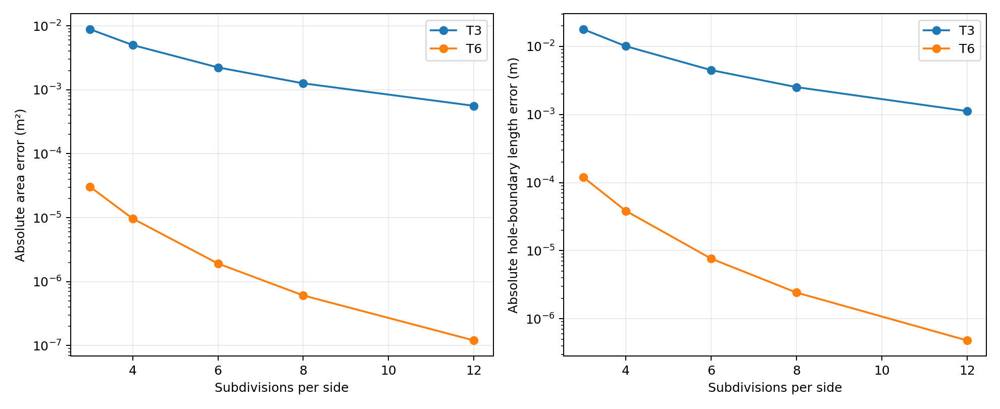
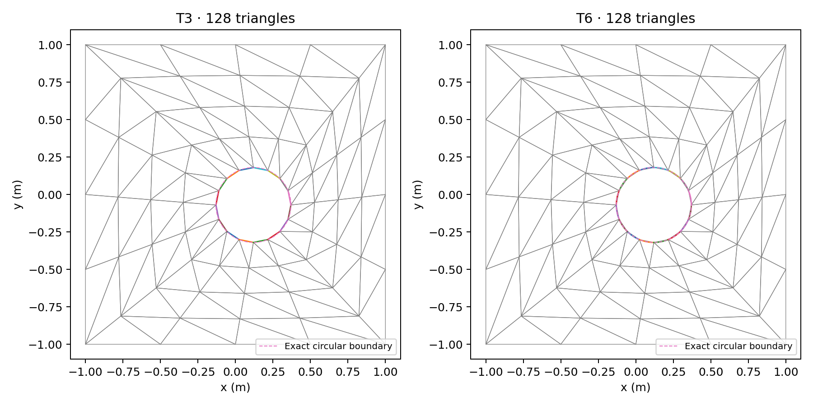

# Circular-hole mesh geometry and numerical verification

**Author:** Mehdi Soroush

**Scope:** Geometrical discretization of a rectangular plate with one circular through-hole. The calculations in this document concern mesh coordinates, connectivity, Jacobians, area, and boundary length; no thermal or mechanical field predictions are asserted.

## Geometry and discretization

A plate of width \(W\) and height \(H\) occupies the outer rectangle
\([-W/2,W/2]\times[-H/2,H/2]\). A circular void of radius \(R\), centred at \((c_x,c_y)\), is excluded from this domain. The hole is strictly interior:

\[
|c_x|+R<W/2,\qquad |c_y|+R<H/2.
\]

Four sectors connect the circular boundary to corresponding sides of the outer rectangle. Each sector has `per_side` circumferential subdivisions; `radial` subdivisions interpolate between the inner and outer contours. Each mapped quadrilateral sector cell is triangulated into two elements, giving \(8\,\mathtt{per\_side}\,\mathtt{radial}\) triangles.

The first-order T3 mesh represents the hole by straight chords. The quadratic T6 mesh uses a shared midside node on every edge. Hole-edge midside nodes are placed on the specified circle, producing nonaffine isoparametric geometric elements. Their curved quadratic edges approximate the circle but are not exact circular arcs.

The geometry utility `thermofem2d.circular_geometry.make_circular_mesh()` returns a `CircularGeometry` object containing `coordinates`, `triangles`, `boundary_edges`, and `boundary_nodes`. This data type is deliberately distinct from the solver-ready rectangular `Mesh`; the existing `make_mesh()` API and its numerical analyses remain unchanged.

## Geometric Jacobian and integration

For the reference triangle \((r,s)\), the isoparametric mapping is

\[
\mathbf{x}(r,s)=\sum_{a=1}^{n_e}N_a(r,s)\mathbf{x}_a,\qquad
J=\frac{\partial\mathbf{x}}{\partial(r,s)},\qquad n_e\in\{3,6\}.
\]

The Jacobian is constant in a straight-sided T3 triangle and generally varies within a curved T6 triangle. Element area is obtained from

\[
A_e=\int_0^1\int_0^{1-r}\det J(r,s)\,\mathrm{d}s\,\mathrm{d}r.
\]

A mapped 5×5 Gauss–Legendre quadrature is used to evaluate this integral. The same order of one-dimensional Gaussian quadrature integrates the approximate quadratic hole-boundary arc length. Positive Jacobians are checked at the numerical integration points, the element vertices, and the edge midpoints. These sampled checks do not constitute a rigorous guarantee of positive Jacobians at every continuous point or a universal mesh-quality certificate.

## Analytical geometry benchmark

The exact area and hole perimeter are

\[
A_{\mathrm{exact}}=WH-\pi R^2,\qquad
L_{\mathrm{exact}}=2\pi R.
\]

For \(W=H=2\,\mathrm{m}\), \(R=0.25\,\mathrm{m}\), and eccentric centre \((0.12,-0.07)\,\mathrm{m}\), the numerical errors are:

| Subdivisions per side and radial direction | T3 area error (m²) | Curved T6 area error (m²) | T3 perimeter error (m) | Curved T6 perimeter error (m) |
| ---: | ---: | ---: | ---: | ---: |
| 6 | 2.235 × 10⁻³ | 1.918 × 10⁻⁶ | 4.482 × 10⁻³ | 7.645 × 10⁻⁶ |
| 8 | 1.259 × 10⁻³ | 6.073 × 10⁻⁷ | 2.522 × 10⁻³ | 2.425 × 10⁻⁶ |
| 12 | 5.603 × 10⁻⁴ | 1.200 × 10⁻⁷ | 1.121 × 10⁻³ | 4.798 × 10⁻⁷ |

The data demonstrate convergence toward the known geometric area and circumference. In this benchmark, the curved T6 geometric approximation has substantially smaller errors than the T3 polygonal representation at corresponding subdivision counts. These are **geometric errors**, not stress, temperature, or convergence-rate certificates for a physical FEM solution.





## Reproducibility

From the repository root, install the package and run:

```bash
python -m pip install -e ".[dev]"
python -m pytest -q tests/test_circular_geometry.py
python examples/scripts/verify_circular_geometry.py
```

Results are written to `results/verification/circular_geometry_convergence.csv` and the two figures above. Automated tests also check boundary tags, midside-node sharing, sampled positive Jacobians, eccentricity, input validation, and backward compatibility of the original rectangular mesh function.

## Applicability and limitations

This contribution is a **geometry-only implementation**. The production thermal, elastic, and coupled transient assemblers still use the established straight-sided element mapping and should not be applied to the new nonaffine geometry. The geometry utility does not accept or produce temperature, stress, or displacement results. Curved-element physical assembly requires separate verification of gradient transformations, volumetric terms, boundary loads, and coupling operators. Hole-edge stress concentration and thermal-shock behavior are not validated by this geometric benchmark.
