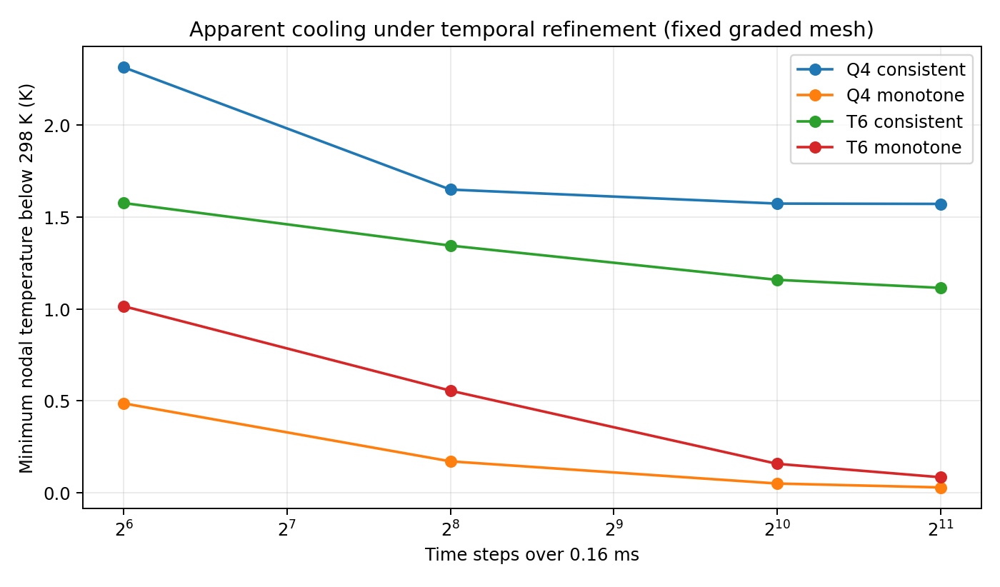
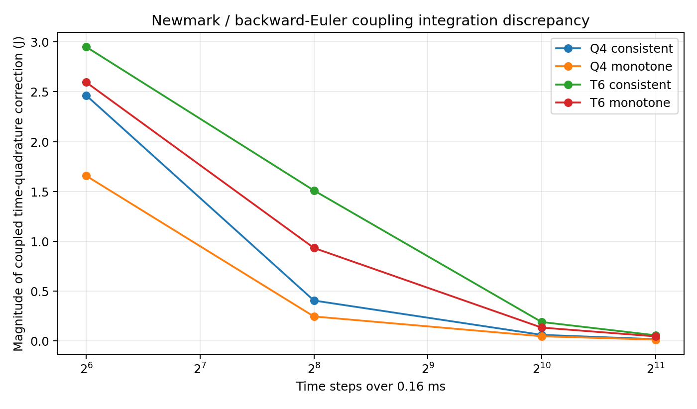
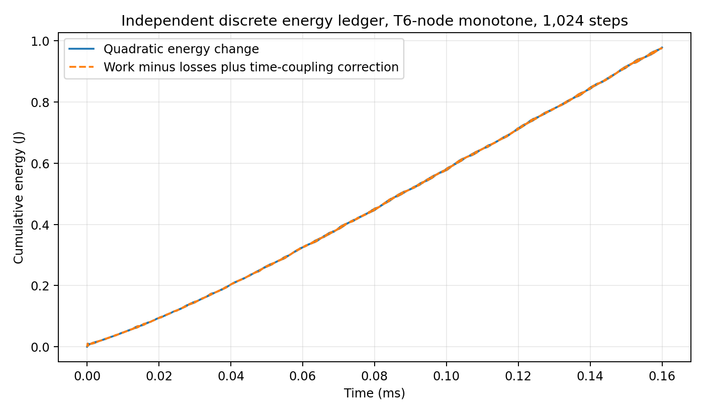

# Two-Way Thermoelastic Energy Budget and Cooling Diagnostics

**Mehdi Soroush**  
**ThermoFEM-2D | v0.7 experimental verification | 15 November 2026**

## Abstract

An independent post-processing audit was developed for the T3, T6, and Q4 transient thermoelastic verification models. The audit reconstructs discrete kinetic, elastic, and thermal perturbation energies from saved nodal histories, evaluates the thermal Dirichlet reaction work, and retains both the dissipation from backward-Euler time integration and the finite-step error caused by evaluating thermoelastic coupling at different time points in the mechanical and thermal equations. The resulting **discrete identity closes to approximately 10⁻¹¹ relative error or better** for the examined fixed graded meshes, but this only confirms arithmetic consistency with the discrete equations. A separate adiabatic affine-strain benchmark validates the *sign* and scale of the strain-rate thermal feedback. Fine time-step studies show that much of the apparent sub-reference cooling is time-integration and spatial-discretization dependent; a converged physical thermal-shock prediction remains unavailable.

## 1. Governing semi-discrete equations

For the constant-property, small-strain, plane-stress model, with temperature perturbation `theta = T - T0`, the coupled matrices satisfy

\[
\mathbf M\ddot{\mathbf u}+\mathbf K_u\mathbf u-\mathbf G\boldsymbol\theta=\mathbf f+\mathbf r_u,
\]

\[
\mathbf C_T\dot{\boldsymbol\theta}+\mathbf K_T\boldsymbol\theta+T_0\mathbf G^{\mathsf T}\dot{\mathbf u}=\mathbf q+\mathbf r_T.
\]

`r_u` and `r_T` denote reactions at prescribed mechanical and thermal degrees of freedom, respectively, using the residual sign convention on the left-hand side. The verification cases have zero support velocities, no distributed heat source, and no imposed heat flux; mechanical loading consists of top-edge traction. In the thermal-shock case, the left and right edge temperatures are held at 310 K and 298 K after an instantaneous boundary change at `t=0+`.

The quadratic **perturbation** energy is

\[
\mathcal E=\frac12\dot{\mathbf u}^{\mathsf T}\mathbf M\dot{\mathbf u}
+\frac12\mathbf u^{\mathsf T}\mathbf K_u\mathbf u
+\frac{1}{2T_0}\boldsymbol\theta^{\mathsf T}\mathbf C_T\boldsymbol\theta.
\]

The last term is a positive quadratic perturbation measure, **not absolute sensible heat**. Its interpretation must not be confused with `1^T C_T (T - T0)` or total thermodynamic internal energy.

For smooth, continuously resolved coupled motion, the reciprocal `G` and `T0 G^T` terms cancel and yield

\[
\frac{d\mathcal E}{dt}
+\frac{1}{T_0}\boldsymbol\theta^{\mathsf T}\mathbf K_T\boldsymbol\theta
=\dot{\mathbf u}^{\mathsf T}(\mathbf f+\mathbf r_u)
+\frac1{T_0}\boldsymbol\theta^{\mathsf T}(\mathbf q+\mathbf r_T).
\]

The thermal conduction term is nonnegative for the positive-semidefinite assembled conductivity matrix. This statement holds for the stated linear reduced constitutive model, not necessarily for unrelated nonlinear or temperature-dependent material laws.

## 2. Exact identity for the numerical time integrator

The existing code uses Newmark average acceleration (`beta=1/4`, `gamma=1/2`) for mechanics and backward Euler for temperature, with coupled unknowns solved simultaneously. These schemes are unconditionally stable in their standard uncoupled linear settings but **do not share the same time-centering for coupling**.

For step `n`, let `v_mid=(v_n+v_(n-1))/2`, `theta_mid=(theta_n+theta_(n-1))/2`, and `delta_theta=theta_n-theta_(n-1)`. The stepwise quadratic energy identity is

\[
\boxed{
\Delta\mathcal E_n+D_{\mathrm{cond},n}+D_{\mathrm{BE},n}
=W_{\mathrm{mech},n}+W_{\mathrm{boundary},n}+R_{\mathrm{mix},n}.
}
\]

The individual terms are

\[
\begin{aligned}
D_{\mathrm{cond},n}&=\frac{\Delta t}{T_0}\boldsymbol\theta_n^{\mathsf T}\mathbf K_T\boldsymbol\theta_n,\\
D_{\mathrm{BE},n}&=\frac{1}{2T_0}\Delta\boldsymbol\theta_n^{\mathsf T}\mathbf C_T\Delta\boldsymbol\theta_n,\\
W_{\mathrm{mech},n}&=\Delta t\,\mathbf v_{\mathrm{mid}}^{\mathsf T}(\mathbf f_n+\mathbf f_{n-1})/2,\\
W_{\mathrm{boundary},n}&=\frac{\Delta t}{T_0}\boldsymbol\theta_n^{\mathsf T}\mathbf r_{T,n},\\
R_{\mathrm{mix},n}&=\Delta t\,[\boldsymbol\theta_{\mathrm{mid}}^{\mathsf T}\mathbf G^{\mathsf T}\mathbf v_{\mathrm{mid}}
-\boldsymbol\theta_n^{\mathsf T}\mathbf G^{\mathsf T}\mathbf v_n].
\end{aligned}
\]

The first term `D_cond` is the conductivity dissipation in the quadratic perturbation balance; `D_BE` is **numerical** thermal damping. The last term `R_mix` is the finite-time-step coupling quadrature correction, and is neither physical heat input nor physical dissipation. Reactions due to fixed mechanical supports produce no power because their prescribed velocity is zero. The thermal boundary reaction is calculated from the **full** thermal residual including the `T0 G^T v` term.

The `t=0+` discrete state already includes the imposed 310 K boundary values. The idealized instantaneous temperature jump and its initial energetic consequences are **outside** the subsequent step-integration interval and must not be counted as an independently validated thermal input.

## 3. Controlled numerical comparison

Model: 2 m × 2 m perforated plate; 0.24 m × 0.20 m eccentric hole; `E=200 GPa`, `nu=0.3`, `alpha=11.7e-6 K^-1`, `rho=7830 kg/m3`, `c=452 J/(kg K)`, `k=54 W/(m K)`, thickness 0.02 m, and reference temperature 298 K. The top traction is an abrupt 2 MPa tensile step. The left boundary is held at 310 K; the right at 298 K; other edges are thermally insulated. Boundary grading uses 22 radial layers, four subdivisions on each outer perimeter side, and radial growth factor 1.45. The final simulation time is 0.16 ms.

| Family and thermal scheme | Time steps | Minimum temperature (K) | Mixed coupling correction (J) | Quadratic energy closure (relative) |
|:--|--:|--:|--:|--:|
| Q4 consistent | 64 | 295.6847 | 2.4637 | 5.6×10⁻¹³ |
| Q4 consistent | 2048 | 296.4279 | 0.01534 | 1.8×10⁻¹¹ |
| Q4 monotone | 64 | 297.5134 | 1.6561 | 4.2×10⁻¹³ |
| Q4 monotone | 2048 | 297.9707 | 0.01120 | 2.6×10⁻¹² |
| T6 consistent | 64 | 296.4233 | 2.9507 | 5.1×10⁻¹³ |
| T6 consistent | 2048 | 296.8848 | 0.05480 | 2.0×10⁻¹² |
| T6-node monotone P1 thermal | 64 | 296.9847 | 2.5951 | 1.4×10⁻¹² |
| T6-node monotone P1 thermal | 2048 | 297.9152 | 0.04377 | 4.2×10⁻¹² |

Additional runs at 256 and 1024 time steps are recorded in `v07_coupled_energy_timestep.csv`. The `T6-node monotone` designation retains quadratic displacements but uses four conforming piecewise-linear thermal subtriangles; it must not be described as a high-order T6 thermal approximation.

Two distinctions follow from these data:

1. The audited discrete **energy identity closes** even for solutions with severe sub-reference temperature excursions. The identity tests consistency with the *numerical equations*, not accuracy against the continuum physical problem.
2. Both the temperature minima and the finite-step coupling correction depend strongly on time step and thermal discretization. The consistent Q4 and T6 schemes retain much larger sub-reference excursions at the finest tested step than their monotone counterparts. The remaining excursions **cannot yet be classified as either physically converged thermoelastic cooling or purely numerical errors**.

The large `R_mix` contribution on coarse time grids is a warning against claiming an uncorrected physical energy balance for the mixed Newmark/backward-Euler scheme. The local M-matrix property of the thermal-only monotone discretization guarantees a maximum principle only for source-free conduction. It does not imply bounds for the fully coupled equation.







## 4. Independent constitutive sign test

For an adiabatic homogeneous isotropic in-plane tensile displacement `u_x=eps*x`, `u_y=eps*y` with `eps=10^-5`, the thermal balance predicts

\[
\Delta T=-\frac{T_0\,\beta}{\rho c}\,\nabla\cdot\mathbf u,
\qquad\beta=\frac{E\alpha}{1-\nu},\qquad\nabla\cdot\mathbf u=2\varepsilon.
\]

The independent scalar constitutive calculation gives **−0.00562942296 K**. The corresponding discretized limiting relation `C_T delta_theta = -T0 G^T delta_u` reproduces the uniform cooling with maximum nodal error below `6×10^-14 K` for T3, Q4, and T6 and for both thermal schemes. This verifies the **sign and dimensional scale** of the local adiabatic coupling. It does not establish the accuracy of the abrupt transient perforated-plate problem.

## 5. Verification methodology and limits

The audit reconstructs acceleration from saved displacement/velocity histories rather than trusting a final stored acceleration, checks the free-node mechanical/thermal residuals, and reconstructs thermal boundary reactions from complete assembled matrices. Deliberately altering an interior temperature entry causes the energy identity to fail, serving as a negative control. Tests also reject feedback-disabled states, for which reciprocal two-way exchange is not present.

The automated regression suite includes cross-family consistency tests and the analytical adiabatic sign test. The audit is an *independent algebraic accounting calculation*, **not an independent spatial FEM implementation or experimental validation**. Its results do not prove thermal-shock convergence or reliable short-time stress predictions.

Important unresolved issues:

- No independently mesh- and time-converged full-domain **two-way** thermal-shock reference. The very small thermal length scale requires both spatial and temporal refinement.
- The mixed-time algorithm has a nonzero `R_mix` term and potentially strong numerical thermal damping on coarse grids. A fully energy-consistent common-midpoint time integrator would be a valuable separate reference, subject to its own positivity and accuracy checks.
- Thermal nodal minima and apparent cooling remain scheme dependent; physically admissible cooling cannot be inferred from a negative value alone.
- The approximate local half-space temperature solution validates only near-edge heat conduction; it does not validate the full two-dimensional coupled perforated-plate response.
- An external established-FEM coupled-shock benchmark has not been performed; cross-platform execution status is reported by the repository CI workflows.

## 6. Reproduction and disposition

From the project root:

```bash
python -m pip install -e ".[dev]"
python -m pytest -q tests/test_coupled_energy_audit.py
python examples/scripts/verify_coupled_energy_audit.py
```

The script writes numerical tables, three measured figures, and a provenance JSON into `results/verification/`. All units, material constants, imposed loads, and the thermal interpolation distinction are retained in these files. The energy audit is separate from the production solver and does not alter its integration equations.

**Scientific limitation:** Credible physical attribution of the remaining temperature excursions requires a validated high-resolution coupled reference and further temporal convergence testing. This discrete accounting calculation is not an engineering-design validation.
