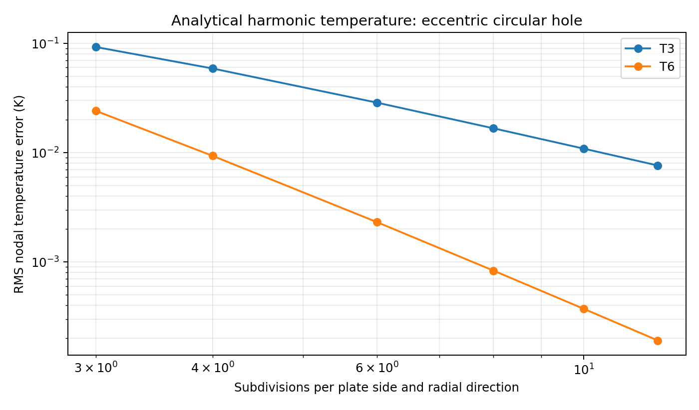

# Curved T6 isoparametric thermal and mechanical finite-element assembly

**Author:** Mehdi Soroush

**Development scope:** Circular-hole field assembly and verification; v0.8 incremental development.

## Mathematical model

The plate is a two-dimensional, homogeneous isotropic body with constant thickness \(h\), conductivity \(k\), density \(\rho\), specific heat \(c\), Young's modulus \(E\), Poisson ratio \(\nu\), and thermal expansion coefficient \(\alpha\). Mechanical kinematics are small-strain plane stress. The formulation is not a geometrically nonlinear or finite-strain theory.

A six-node isoparametric triangle has local connectivity

`[v0, v1, v2, m01, m12, m20]`.

For parent coordinates \((r,s)\), \(L=(1-r-s,r,s)\), the usual quadratic Lagrange functions are used for **both** the physical mapping and the displacement/temperature fields:

\[
\mathbf{x}(r,s)=\sum_{a=1}^{6}N_a(r,s)\mathbf{x}_a,\qquad
T(r,s)=\sum_{a=1}^{6}N_aT_a,\qquad
\mathbf{u}(r,s)=\sum_{a=1}^{6}N_a\mathbf{u}_a.
\]

The geometric Jacobian is

\[
J=\frac{\partial(x,y)}{\partial(r,s)},\qquad
\nabla_{x,y}N=\nabla_{r,s}N\,J^{-1},\qquad
\mathrm{d}\Omega=\det(J)\,\mathrm{d}r\,\mathrm{d}s.
\]

For a curved edge, \(J\) is not constant. Using only the three vertex coordinates in the physical gradient transformation is therefore incorrect. Curved cells are assembled with a mapped 5×5 Gauss–Legendre rule on the parent triangle (weights normalized to sum to one, with an explicit local \(\det J/2\) factor). Straight-sided production meshes retain the established six-point affine integration path.

The following local operators are assembled by numerical quadrature:

\[
\begin{aligned}
K_T^e &= h\int_{\Omega_e} k\,(\nabla N)^\mathsf{T}\nabla N\,\mathrm d\Omega,\\
C_T^e &= h\int_{\Omega_e}\rho c\,N^\mathsf{T}N\,\mathrm d\Omega,\\
K_u^e &= h\int_{\Omega_e}B^\mathsf{T}D_{ps}B\,\mathrm d\Omega,\\
M^e &= h\int_{\Omega_e}\rho\,\mathcal N_u^\mathsf{T}\mathcal N_u\,\mathrm d\Omega,\\
G^e &= h\int_{\Omega_e}B^\mathsf{T}D_{ps}\alpha\,(1,1,0)^\mathsf{T}N\,\mathrm d\Omega.
\end{aligned}
\]

Here \(B\) uses engineering shear strain and \(\mathcal N_u\) maps nodal displacements to physical displacement components. The thermal force for a temperature perturbation \(\theta=T-T_{ref}\) equals \(G\theta\), and the reciprocal heat-equation velocity term is \(T_{ref}G^\mathsf{T}\dot{u}\). The assembly therefore includes thermal conductivity, consistent heat capacity, plane-stress stiffness, consistent structural mass, and reciprocal coupling blocks.

The implementation integrates constant edge fluxes and Cartesian tractions along the **quadratic geometric edge**:

\[
f_{\Gamma,a}=h\int_{-1}^{1}N_a(\xi)\,\mathbf{t}\,\left\|\frac{\partial\mathbf{x}}{\partial\xi}\right\|\mathrm d\xi.
\]

An analogous scalar integral applies to prescribed inward heat flux. Quadratic edges are geometric polynomial approximations of the circle, not exact arcs. Edge integration is performed with a five-point Gauss–Legendre rule.

## Geometry-to-assembly boundary

`thermofem2d.circular_geometry.make_circular_mesh()` continues to return a distinct `CircularGeometry` object. The explicit conversion function `thermofem2d.curved_field.circular_field_mesh()` checks connectivity, boundary labels, sampled Jacobian positivity, and copies coordinates into the assembly-compatible `Mesh` structure. The normal JSON/CLI and Streamlit geometry options remain restricted to their existing supported configurations. This contribution does not add a selectable circular geometry to the general application.

Sampled positive Jacobians at integration points and vertices are necessary numerical checks, not a global proof of map invertibility for arbitrary meshes.

## Analytical and algebraic verification

**Harmonic conduction.** On an eccentric circular-hole plate with \(W=H=2\,\mathrm m\), \(R=0.25\,\mathrm m\), and centre \((0.12,-0.07)\,\mathrm m\), the exact harmonic field

\[
T^*(x,y)=300+8\ln\left(\frac{\sqrt{(x-0.12)^2+(y+0.07)^2}}{0.25}\right)
\]

satisfies \(\nabla^2T^*=0\) throughout the solid. Exact temperatures are imposed at every node on both the outer boundary and the hole. The table reports RMS nodal error over the full computational mesh; the prescribed boundary nodes contribute zero error by construction.

| Subdivisions per side/radial direction | T3 RMS error (K) | Curved T6 RMS error (K) |
| ---: | ---: | ---: |
| 3 | 0.0923606 | 0.0240762 |
| 4 | 0.0587807 | 0.00934565 |
| 6 | 0.0286504 | 0.00231574 |
| 8 | 0.0166735 | 0.000833315 |
| 10 | 0.0108586 | 0.000372209 |
| 12 | 0.00762162 | 0.000191481 |



**Mechanical patch tests.** An affine displacement is applied on all physical boundary nodes. The computed interior displacements and stresses reproduce the corresponding constant-strain linear-elastic solution to floating-point precision. A spatially uniform temperature rise with compatible freely expanding displacement produces negligible elastic stress. The benchmark is a prescribed-boundary patch test, **not** a test of circular-hole stress concentration under remote tension.

**Matrix and boundary checks.** The consistent thermal capacity under a constant nodal temperature integrates to \(\rho ch A\). Constant translational velocity produces kinetic mass \(\rho h A\) per displacement component. Thermal stiffness has a constant-temperature null mode; conductivity/capacity and elastic/mass operators are symmetric to numerical precision. The thermal coupling matrix reproduces the analytically integrated work of affine dilatation under a spatially uniform temperature perturbation. Constant edge load resultants equal the load density multiplied by the quadratically integrated hole perimeter and, for traction, plate thickness.

The benchmark uses the current project's assumed constant material properties and carries no comparison with experiments or historical 2016 numerical outputs. The exact harmonic temperature field is a manufactured analytical check, not an observed material response.

## Reproduce

From the project root (Python 3.11+):

```bash
python -m pip install -e ".[dev]"
python -m pytest -q tests/test_curved_field.py
python examples/scripts/verify_curved_fields.py
```

Outputs are `results/verification/circular_curved_field_convergence.csv` and `results/verification/circular_curved_heat_convergence.png`.

## Limitations and next validation

- The modified assembly operators support circular T3 and curved T6 meshes passed through the explicit adapter, but general CLI/Streamlit model dispatch does not accept circular holes.
- The present temperature benchmark tests steady homogeneous conduction. It does not validate mixed thermal boundary conditions, transient thermal-shock accuracy, or temperature-dependent material properties on circular geometry.
- The mechanical patch tests verify the operator's constant-strain consistency. Curved-hole stress-concentration factors, hole-surface pressure response, local stress convergence, and external established-FEM comparisons remain to be established.
- The consistent mass and reciprocal coupling blocks have algebraic checks, but this contribution does **not** claim validation of the full transient curved-hole thermoelastic response.
- The conventional centroid sampling of stress and heat flux does not imply convergence of local peak values near geometric or boundary singularities.
