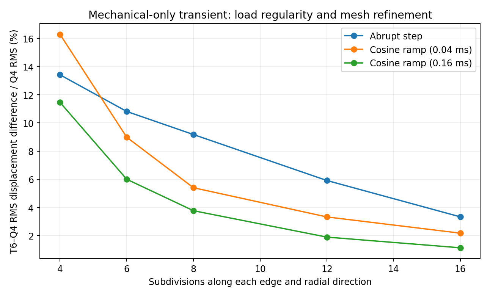
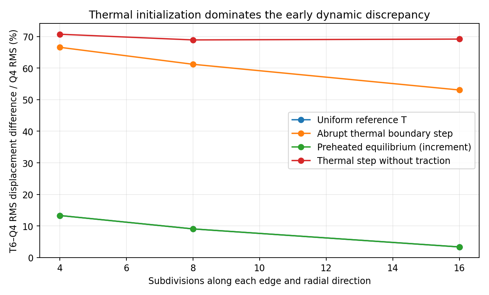
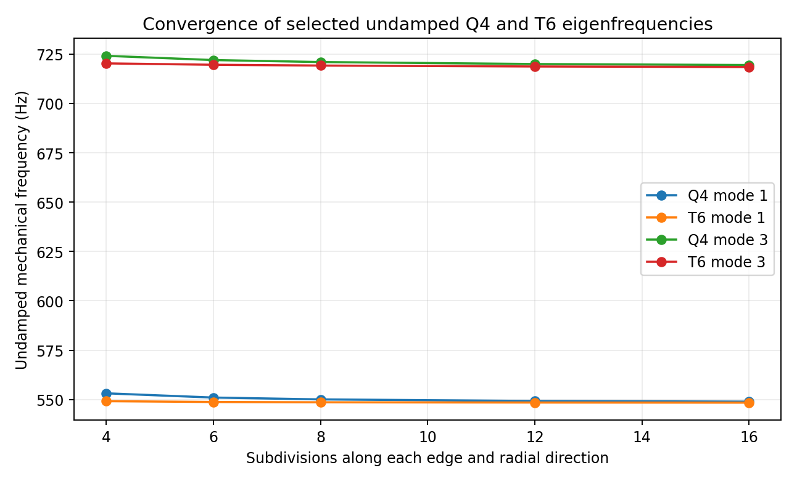
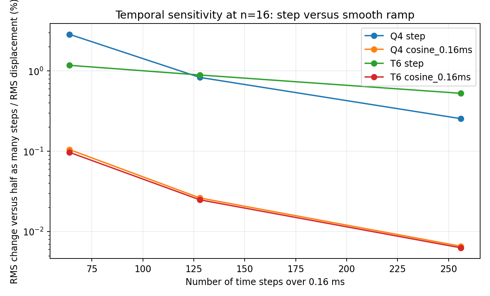
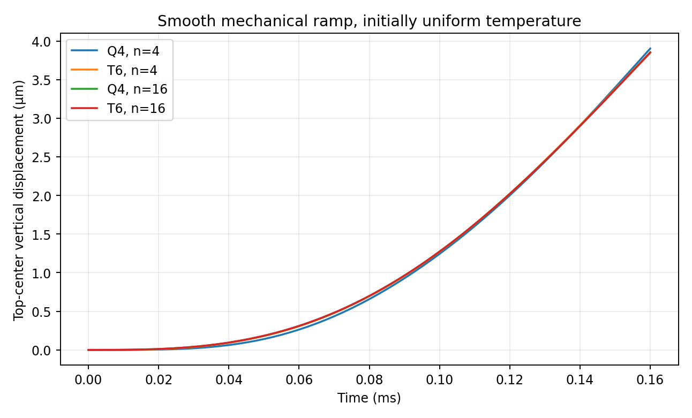
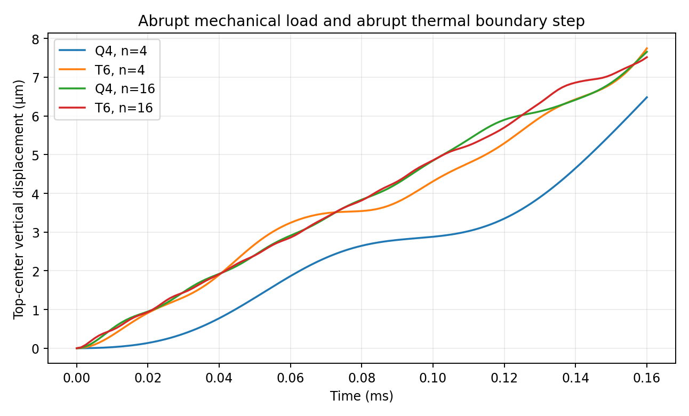

# Dynamic Wave Validation: Load Regularity, Thermal Initialization, and Q4–T6 Comparison

**ThermoFEM-2D numerical verification study, November 2026**  
**Author:** Mehdi Soroush  
**Implementation:** Linear plane-stress thermoelasticity; independently assembled Q4 and T3/T6 spatial finite elements  
**Evidence status:** Internal cross-formulation verification, not experimental or external-package validation

## Abstract

A previously identified 63–67% discrepancy between Q4 and T6 displacement fields during the early response of a suddenly loaded, thermally perturbed perforated plate prompted a controlled investigation of initial conditions, mechanical loading rates, spatial resolution, temporal resolution, and natural frequencies. The principal finding is that the large discrepancy is associated predominantly with the abruptly imposed temperature boundary condition and its severely under-resolved thermal boundary layer. When the calculation is restricted to mechanical excitation at uniform reference temperature, T6–Q4 differences at the observation time decline monotonically with mesh refinement. A sufficiently gradual mechanical ramp (0.16 ms rise) improves agreement further. A distinct initial-equilibrium test confirms that static preheating followed by mechanical loading produces much smaller differences in the *incremental* response than abrupt thermal initialization. The modal frequencies converge toward one another as the mesh is refined. The findings explain the earlier comparison without establishing a converged solution to the original thermal-shock problem.

## 1. Model and independently assembled discretizations

The two-dimensional plate has width and height 2.0 m, an eccentric rectangular opening 0.24 m × 0.20 m, and opening centre (0.12, −0.08) m. The material is homogeneous, isotropic and linearly elastic with

| Property | Value |
| --- | ---: |
| Young's modulus, E | 200 GPa |
| Poisson's ratio, ν | 0.30 |
| Density, ρ | 7830 kg/m³ |
| Thermal conductivity, k | 54 W/(m K) |
| Specific heat, c | 452 J/(kg K) |
| Thermal expansion coefficient, α | 11.7 × 10⁻⁶ K⁻¹ |
| Plate thickness | 0.02 m |
| Reference temperature, T₀ | 298 K |

The boundary constraints are `u_x=0` on the left edge and `u_y=0` on the bottom edge. Mechanical traction is applied in the positive vertical direction on the top edge, with final magnitude 2 MPa. The chosen constraints suppress rigid-body modes and permit consistent reference eigenanalysis. All boundaries of the hole remain mechanically traction-free.

The coupled semidiscrete equations are

\[
M_u \ddot u+K_u u-G\theta=f(t), \qquad
C_T\dot\theta+K_T\theta+T_0 G^T\dot u=q(t),
\]

with \(\theta=T-T_0\). `T3` and `T6` employ the production triangular implementation. `Q4` uses a separate conforming quadrilateral mesh and its own element shape functions, quadrature, thermal matrices, elastic matrices, mass matrices, and coupling matrices. The time-stepping benchmark employs the same Newmark average-acceleration/backward-Euler scheme for all three discretizations, so the **independence is spatial, not temporal**. This is not a comparison with commercial FEM software.

The relevant mesh-vertex coordinates are matched exactly across Q4 and T6. Displacement comparisons use **only these shared vertices**, excluding the extra T6 midside DOFs. The primary metric is

\[
e_u(t)=\frac{\sqrt{\frac{1}{N}\sum_{i=1}^N\lVert u^{T6}_i(t)-u^{Q4}_i(t)\rVert^2}}
{\sqrt{\frac{1}{N}\sum_{i=1}^N\lVert u^{Q4}_i(t)\rVert^2}}.
\]

The accompanying CSVs retain both the numerator in metres and the Q4 RMS denominator; relative percentages are not interpreted in isolation. Normalization by the reference Q4 static-traction displacement is also provided. The observation time is 0.16 ms unless otherwise stated.

## 2. Mechanical load regularity

Two temporal amplitudes have been applied to the constant 2 MPa traction:

\[
g_{\rm step}(t)=1\quad(t\geq0),
\]

\[
g_{\rm ramp}(t)=\begin{cases}
\tfrac12[1-\cos(\pi t/\tau)] & 0\leq t\leq\tau,\\
1&t>\tau.
\end{cases}
\]

The step-load initial acceleration is consistent with a load active at time zero; the smooth ramp starts from zero load and has zero derivative at both ends. Tested rise times are 0.04 and 0.16 ms. Mechanical-only comparisons begin at a spatially uniform 298 K, with no thermal feedback, to isolate elastic-wave discretization effects. The final observation time is fixed at 0.16 ms and 64 time steps are used for this mesh series.

| Subdivisions per edge/radial direction | Abrupt traction: Q4–T6 difference | 0.16 ms cosine ramp: Q4–T6 difference |
| ---: | ---: | ---: |
| 4 | 13.42% | 11.46% |
| 6 | 10.82% | 6.00% |
| 8 | 9.18% | 3.76% |
| 12 | 5.91% | 1.89% |
| 16 | 3.32% | 1.13% |

The absolute RMS discrepancy for the 0.16 ms ramp declines from 1.21 × 10⁻⁷ m (n=4) to 9.89 × 10⁻⁹ m (n=16). Both the relative and absolute discrepancies decrease with refinement in this case. This is evidence of **cross-formulation consistency**, not a known-error estimate relative to an exact continuum solution.



## 3. Thermal initialization controls

Four distinct starting conditions are considered with two-way thermal feedback enabled:

1. **Uniform-reference start:** all nodes initially at 298 K; mechanical traction changes at time zero.
2. **Abrupt thermal-boundary step:** at the initial time, 310 K is imposed on the left edge and 298 K on the right, while interior nodes start at 298 K. The mechanical initial displacement is zero. This reproduces the original model configuration and launches both mechanical and thermal transients.
3. **Preheated equilibrium:** the temperature starts from the steady conduction solution under the same left/right temperatures, and displacement starts from its corresponding static thermoelastic equilibrium. The comparison is made for *increments relative to each model's own equilibrium* after applying the mechanical traction.
4. **Thermal step only:** the abrupt thermal boundary step is retained but the mechanical traction is set to zero.

These are different physical initial-value problems, not interchangeable ways of imposing the same thermal shock.

| Subdivisions | Uniform-reference start | Abrupt thermal step | Preheated equilibrium* | Thermal step without traction |
| ---: | ---: | ---: | ---: | ---: |
| 4 | 13.31% | 66.58% | 13.31% | 70.72% |
| 8 | 9.07% | 61.20% | 9.07% | 68.92% |
| 16 | 3.35% | 53.06% | 3.35% | 69.18% |

*The equilibrium comparison is based on **incremental** displacement rather than absolute total displacement; the initial Q4 and T6 static equilibria need not coincide exactly.*

The 66.58% discrepancy on the four-subdivision mesh is consistent with the previously reported approximately 63–67% short-time discrepancy. The diagnostic harness was checked directly against the original production T6 solver and the separately assembled Q4 reference: their time histories agree to numerical precision for the original abrupt thermal initialization.

With **zero mechanical traction**, the abrupt thermal boundary step alone still generates an approximately 69–71% relative displacement discrepancy over these meshes. Consequently, the large earlier discrepancy cannot be attributed solely to mechanical-wave dispersion or the time-integration method. The absolute thermal-only differences decrease with refinement, but their percentage relative to the simultaneous Q4 response remains high. This is **not** a converged thermal-shock simulation.



## 4. Thermal diffusion length and physical resolution

The isotropic thermal diffusivity is

\[
\alpha_T=\frac{k}{\rho c}=1.526\times10^{-5}\ {\rm m^2/s}.
\]

At t=0.16 ms, the characteristic diffusion distance is

\[
\ell_T=\sqrt{\alpha_T t}=4.94\times 10^{-5}\ {\rm m}=0.0494\ {\rm mm}.
\]

For the ideal one-dimensional semi-infinite conduction solution subjected to a temperature step, the distance at which the temperature perturbation has fallen to 1% of its boundary value is approximately 0.180 mm. This **one-dimensional estimate is a scale argument**, not an exact solution for the finite, holed plate.

The minimum vertical ligament between the opening and the outer boundary is 0.82 m. At n=16, the representative radial mesh spacing in this region is about **51.25 mm**, approximately **1037 times** the characteristic diffusion distance and **285 times** the 1% penetration depth. Linear or quadratic elements spread the prescribed boundary temperature across elements that are orders of magnitude larger than the physical early-time conduction layer. The sudden thermal boundary condition therefore creates a highly mesh-sensitive thermal strain distribution and associated elastic wave response.

The approximate in-plane longitudinal and shear wave speeds for the selected plane-stress model are 5.30 km/s and 3.13 km/s, respectively. The corresponding 2 m travel times are approximately 0.377 and 0.638 ms, longer than the 0.16 ms observation window. The comparison samples an early-time wave field rather than a settled or quasi-static displacement state.

**Consequence:** reliable thermal-shock assessment requires a near-boundary mesh or alternative spatial treatment capable of resolving the thermal diffusion layer, and independent thermal/transient benchmarks. Increasing polynomial order on the same coarse thermal boundary layer is not by itself an adequate remedy.

## 5. Modal evidence and temporal refinement

The lowest undamped mechanical frequencies are obtained separately from the Q4 and T6 generalized eigenproblems, with identical physical supports and with thermal feedback disabled for the modal analysis.

| Subdivisions | Q4 first frequency (Hz) | T6 first frequency (Hz) | Relative difference |
| ---: | ---: | ---: | ---: |
| 4 | 553.141 | 549.161 | 0.725% |
| 8 | 550.058 | 548.594 | 0.267% |
| 16 | 548.925 | 548.419 | 0.092% |

The first several eigenfrequencies show similar convergence, although the lowest modes do not characterize the high-frequency response excited by abrupt loading. The generated modal data cover six modes for each mesh and element family.



At 16 subdivisions, a time-step refinement study compares 256 against 128 time steps over the same 0.16 ms interval. The **successive-refinement displacement changes** are:

| Element | Abrupt mechanical step | Smooth 0.16 ms ramp |
| --- | ---: | ---: |
| Q4 | 0.2545% | 0.0066% |
| T6 | 0.5263% | 0.0063% |

These are differences between two numerical time resolutions, **not exact integration errors**. The smooth-ramp endpoint is substantially less sensitive to time-step refinement. Abrupt-load high-frequency accuracy still warrants finer time resolution and a more highly resolved independent continuum benchmark.



The following top-centre vertex histories illustrate the time dependence of the two discretizations for coarse and refined meshes. The uniform-temperature case uses a smooth mechanical ramp; the thermal-step case uses simultaneous abrupt mechanical and thermal boundary loading.





## 6. Reproducibility and coverage

From the repository root, with Python 3.11+ and the development dependencies installed:

```bash
python -m pip install -e ".[dev]"
python -m pytest -q tests/test_dynamic_diagnostics.py
python examples/scripts/validate_dynamic_waves.py
```

The script writes `v07_mechanical_wave_convergence.csv`, `v07_thermal_initialization.csv`, `v07_modal_frequencies.csv`, `v07_time_step_sensitivity.csv`, `v07_probe_history.csv`, and `v07_summary.json` to `results/verification/`, together with the six accompanying PNG plots.

The diagnostics test both an independent Q4 spatial assembly and the production T6 assembly; the time-integrator structure is shared. Regression tests verify the original abrupt-load outputs of both public solver paths, stationary thermal–mechanical equilibria, ramp behavior, eigenvalue consistency, thermal-initialization sensitivity, and temporal refinement. The reference temperature and source boundary conditions are recorded explicitly in the reproducibility script.

## 7. Interpretation, limitations, and next validation gates

The original large Q4–T6 discrepancy has been **localized**, but the abrupt thermal-shock solution has **not been fully validated**. A thermal-only version of the same initial-value problem produces a comparable discrepancy, and characteristic penetration lengths are far smaller than the geometric element sizes. The smooth, initially uniform mechanical problem gives convergent cross-formulation results and supports the correctness of the underlying structural spatial discretizations in that regime.

A future thermal-shock benchmark must resolve the near-edge transient temperature field and its thermally induced stresses using validated reference solutions, graded meshes, or an appropriate independent FEM package. Additional useful checks include mechanical energy and external work for ramp loading, wave-front timing, higher-mode convergence, boundary reactions, and spatially resolved strain/stress errors. Pointwise stress maxima near rectangular-hole corners are not suitable convergence targets without singularity analysis.

**Verification classification:** Independent-in-space Q4/T6 comparison and analytical physical-scale diagnostics; **not** independent-in-time integration, experimental validation, external commercial-FEM validation, or exact reproduction of historical MATLAB results.
