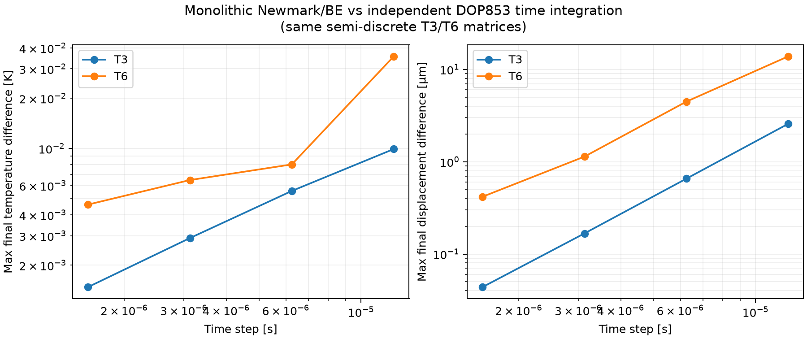
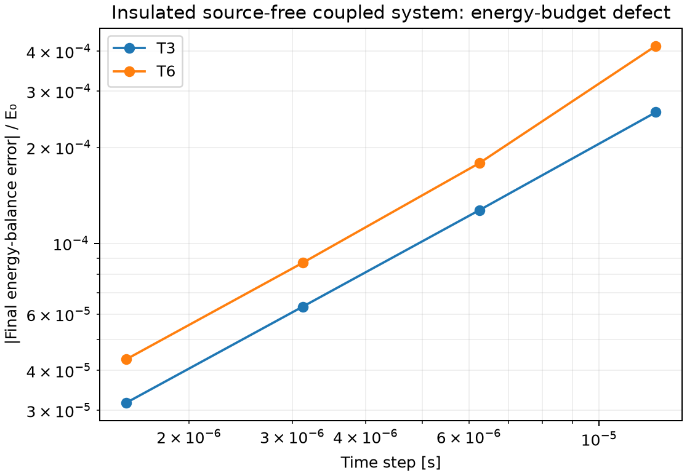
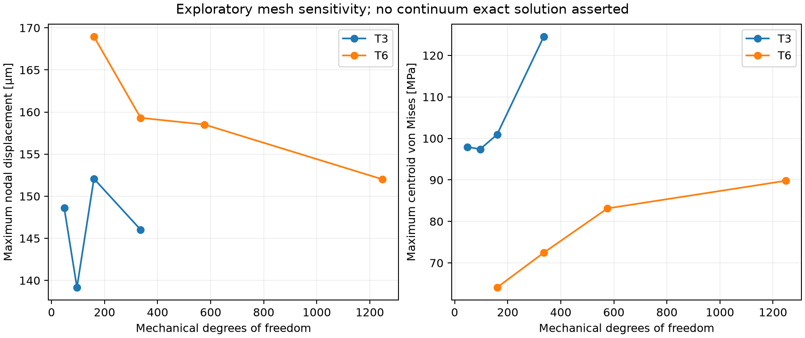

# Coupled time-integration verification and energy budget — v0.4.0

## Scope and classification of evidence

This release verifies the transient **T3/T6** plane-stress formulation along three complementary routes:

1. **Independent *time integrator*:** SciPy `solve_ivp(method="DOP853")` integrates a separately assembled first-order method-of-lines system to tight tolerances (`rtol=2e-10`, `atol=1e-11`). It uses the **same FE mass, stiffness, and coupling matrices** as the production solver. Therefore it is an independent check of the Newmark/backward-Euler time advance, **not** an independent spatial FEM, an analytical continuum solution, or an Abaqus comparison.
2. **Thermodynamic energy balance:** for insulated boundaries, zero prescribed support motions, and no heat/traction sources, a continuum-derived energy and dissipation identity is evaluated directly from computed fields. Its defect is expected to approach zero as the time step decreases, but the present Newmark/backward-Euler combination is **not** an exactly energy-conserving time discretization.
3. **Exploratory spatial sensitivity:** T3/T6 analyses on several meshes compare global measures and local element-centroid stress diagnostics. No exact solution or converged peak-stress value is asserted.

The underlying 2016 coursework used the general classical coupled thermoelastic equations. The present version is a new **reduced plane-stress, constant-coefficient** implementation. Its element matrices and numerical results have **not** yet been independently validated in another FE code.

## Semi-discrete equations

Let `theta = T - T_ref` and define free constrained DOFs after elimination:

\[
M\ddot u+K_u u-G\theta=f,\quad
C_T\dot\theta+K_T\theta+T_{ref}G^T\dot u=q.
\]

`verification.solve_semidiscrete_ode` independently forms the first-order ODE:

\[
\dot u=v,\quad
\dot v=M_{ff}^{-1}(f+G\theta-K_uu)_f,\quad
\dot\theta_f=(C_T)_{ff}^{-1}(q-K_T\theta-T_{ref}G^Tv)_f.
\]

It handles the same **constant** displacement/temperature Dirichlet values and constant loads as the production solver, with zero initial displacement and velocity. The vector valued initial temperature is supported in two formats: a scalar kelvin value, or an explicitly affine field

```json
"initial_temperature": {"type": "affine", "base": 310.0, "gx": 6.0, "gy": -3.0}
```

where `gx` and `gy` are in K/m. An affine initial field makes the insulated heat-conduction term nonzero and provides a richer energy test. No arbitrary code evaluation or time-dependent prescribed data is involved.

**Production method:** Newmark average acceleration (`beta=1/4`, `gamma=1/2`) and backward Euler for temperature in one sparse monolithic solve per step. **Reference method:** SciPy DOP853's adaptive explicit high-order ODE integration with factored consistent mass/capacity matrices. Tight tolerances on this small 32-element mesh make the reference error much smaller than the tested production-step errors; this is not a proof of exactness.

## Reproducible temporal convergence

The benchmark uses a 2 m × 2 m plate with one offset rectangular opening, the elastic/thermal constants from `examples/coupled_plate_t6.json`, an **insulated boundary** (natural zero heat flux), no traction, and homogeneous displacement restraints `ux=0` on `left`, `uy=0` on `bottom`. The initial temperature is `310 + 6x − 3y` K. The integration ends at `t = 1e-4 s`, with identical geometry and FE matrices at each refinement level. Both element types use the same 32-triangle parent mesh (T3: 24 nodes; T6: 80 nodes).

| Element | Time steps | dt (s) | Maximum final temperature difference (K) | Maximum final displacement difference (µm) |
|---|---:|---:|---:|---:|
| T3 | 8 | 1.25e-5 | 0.009923 | 2.578 |
| T3 | 16 | 6.25e-6 | 0.005566 | 0.655 |
| T3 | 32 | 3.125e-6 | 0.002905 | 0.167 |
| T3 | 64 | 1.5625e-6 | 0.001477 | 0.0438 |
| T6 | 8 | 1.25e-5 | 0.035635 | 13.846 |
| T6 | 16 | 6.25e-6 | 0.008025 | 4.474 |
| T6 | 32 | 3.125e-6 | 0.006467 | 1.135 |
| T6 | 64 | 1.5625e-6 | 0.004609 | 0.417 |

These are **absolute differences between numerical time integrators on the same mesh**, not continuum discretization errors. Their reduction indicates temporal consistency over the tested horizon; the T6 temperature sequence is not monotone in an ideal power-law ratio, so we do **not** claim a measured formal convergence order.

The dimensionless residual of the reference semi-discrete free-DOF equations, normalized as specified in the implementation, was below `1.5e-16` for the listed cases. This checks algebraic consistency of the ODE reference; it does **not** quantify spatial discretization error.



## Energy and thermal dissipation

For `q=f=0`, homogeneous fixed supports and insulated thermal boundaries, with **positive absolute reference temperature** `T_ref > 0 K`, the continuum reduced model satisfies:

\[
E=\tfrac12\dot u^TM\dot u+\tfrac12u^TK_uu+
\tfrac1{2T_{ref}}\theta^TC_T\theta,
\qquad D=\frac{\theta^TK_T\theta}{T_{ref}}\ge 0,
\]

\[
E(t)-E(0)+\int_0^t D(\tau)\,d\tau=0.
\]

The cross coupling cancels because the structural block uses `-G theta` and the energy equation uses `+T_ref G.T u_dot`. These are the **linearized** thermoelastic perturbation energy/dissipation measures, not a nonlinear total internal-energy balance.

For each numerical trajectory, the code evaluates `E` at saved states and approximates the dissipation integral by the trapezoidal rule. The absolute balance defect, divided by the initial energy, decreases under refinement:

| Element | 8 steps | 16 steps | 32 steps | 64 steps |
|---|---:|---:|---:|---:|
| T3 | 2.58e-4 | 1.27e-4 | 6.34e-5 | 3.17e-5 |
| T6 | 4.16e-4 | 1.79e-4 | 8.70e-5 | 4.34e-5 |

The integrator itself introduces artificial dissipative effects; the trend toward zero defect is more meaningful than the energy defect at any one time step. The positivity of the computed conductive dissipation was checked throughout the scenarios.



## Spatial sensitivity: **not** a mesh-convergence certificate

The same short coupled transient was solved with `per_side=radial` equal to 2, 3, 4 and 6, separately for T3 and T6. The effective temperature average is **area-weighted**. Stress is sampled **only at parent-element centroids**; these peak values are sensitive to mesh density and evaluation location, and sharp hole corners can produce stress singularities.

| Element | Parent elements | Mechanical DOFs | Maximum nodal displacement (µm) | Maximum centroid von Mises (MPa) |
|---|---:|---:|---:|---:|
| T3 | 32 | 48 | 148.61 | 97.94 |
| T3 | 72 | 96 | 139.17 | 97.40 |
| T3 | 128 | 160 | 152.08 | 100.95 |
| T3 | 288 | 336 | 146.03 | 124.54 |
| T6 | 32 | 160 | 168.96 | 64.09 |
| T6 | 72 | 336 | 159.31 | 72.46 |
| T6 | 128 | 576 | 158.52 | 83.14 |
| T6 | 288 | 1248 | 152.00 | 89.79 |

**Do not use these raw peak stresses as converged engineering design stresses.** A rigorous spatial study would need an independently benchmarked geometry/problem, carefully defined stress points or path quantities, and convergence of appropriately regular quantities.



## How to reproduce

```bash
python -m pip install -e ".[dev]"
python -m pytest -q
python examples/scripts/verify_coupled_convergence.py
```

Generated outputs in `results/verification/`:

- `coupled_time_convergence.csv` and `.png`
- `coupled_energy_balance.csv` and `.png`
- `coupled_spatial_sensitivity.csv` and `.png`

## Verification boundaries and next required work

- **Completed:** algebraic reciprocity, linearized energy identity diagnostics, separate high-accuracy temporal integration, T3/T6 temporal refinement, selected spatial-sensitivity cases, earlier thermal manufactured solutions and mechanical patch tests.
- **Not completed:** independent *spatial* implementation of the coupled problem, comparison with Abaqus/another verified package, measured convergence of physically regular stress quantities, experimental validation, arbitrary boundary functions, nonlinear constitutive response, or a like-for-like reconstruction of original 2016 numerical results.
- No claim is made that an internal method-of-lines comparison removes shared FEM assembly errors.
