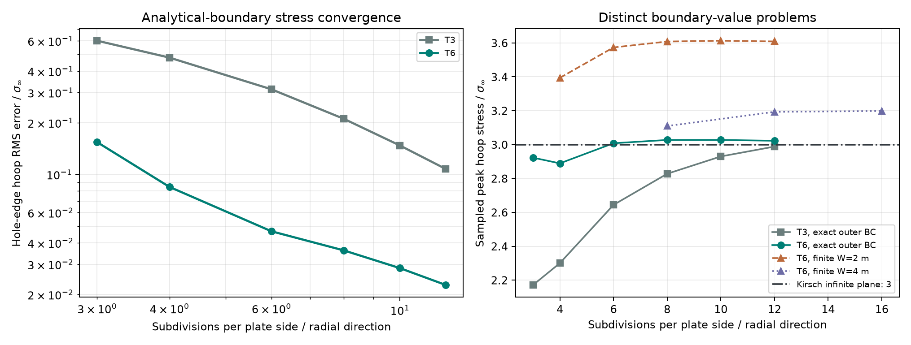
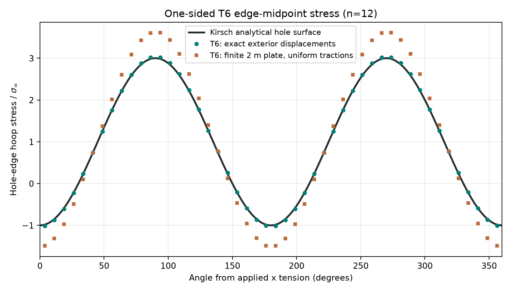

# Analytical Kirsch stress verification and finite-width circular-hole tension

**Author:** Mehdi Soroush

**Scope:** Static, small-strain isotropic plane-stress verification on circular-hole T3 and curved T6 meshes, within the v0.8 research verification extensions.

## Verification questions

This benchmark tests whether the curved-element mechanical assembly and unsmoothed hole-boundary stress recovery reproduce an independently known **nonuniform elasticity field**. It separates two distinct boundary-value problems:

1. **Analytical-exterior Dirichlet benchmark.** A square computational subdomain is prescribed the *exact infinite-plane Kirsch displacement* on all four exterior edges. The hole has a zero **natural** traction condition. The exact continuum Kirsch stress field is therefore a valid analytical comparison for this particular bounded problem, except for geometric approximation of the circular edge.
2. **Finite uniformly loaded plate.** A centred square plate is subjected to equal-and-opposite uniform Cartesian tractions on its left and right exterior edges. The top, bottom, and hole are free. It is a different physical problem, and its stress-concentration factor is not expected to equal three at a finite hole-to-width ratio.

All plotted and tabulated values are calculated by ThermoFEM-2D's 2026 Python finite-element implementation. No 2016 MATLAB output, laboratory measurements, material failure criterion, or third-party finite-element dataset has been used for calibration.

## Governing analytical reference

An infinite plane with an unloaded circular hole of radius \(a\) and far-field uniform tensile stress \(\sigma_\infty\) in the Cartesian \(x\) direction has the classical Kirsch stresses. Writing \(q=a^2/r^2\), with \(\theta\) measured counterclockwise from \(+x\),

\[
\begin{aligned}
\sigma_{rr}/\sigma_\infty &= \tfrac12\left[(1-q)+(1-4q+3q^2)\cos 2\theta\right],\\
\sigma_{\theta\theta}/\sigma_\infty &= \tfrac12\left[(1+q)-(1+3q^2)\cos 2\theta\right],\\
\tau_{r\theta}/\sigma_\infty &= -\tfrac12(1+2q-3q^2)\sin 2\theta.
\end{aligned}
\]

At \(r=a\), \(\sigma_{rr}=\tau_{r\theta}=0\) and \(\sigma_{\theta\theta}=\sigma_\infty(1-2\cos2\theta)\). For positive \(x\)-directed remote tension, the maximum is \(3\sigma_\infty\) at \(\theta=90^\circ,270^\circ\), and the minimum is \(-\sigma_\infty\) at \(0^\circ,180^\circ\). References defining the same stress orientation and equations are included below.

For a homogeneous isotropic **plane-stress** material, the compatible displacement solution used to prescribe the exterior nodes is

\[
\begin{aligned}
u_r &= \frac{\sigma_\infty}{2E}\left[(1-\nu)r+(1+\nu)\frac{a^2}{r}
+\left((1+\nu)r+4\frac{a^2}{r}-(1+\nu)\frac{a^4}{r^3}\right)\cos2\theta\right],\\
u_\theta &= -\frac{\sigma_\infty}{2E}\left[(1+\nu)r+2(1-\nu)\frac{a^2}{r}
+(1+\nu)\frac{a^4}{r^3}\right]\sin2\theta.
\end{aligned}
\]

These displacements are defined up to rigid translation and rotation; the stated form fixes them to zero. The expressions are verified numerically in `tests/test_kirsch.py` by differentiating displacement and independently reconstructing the Cartesian Kirsch stress through the plane-stress constitutive matrix. The conversion \((u_r,u_\theta)\mapsto(u_x,u_y)\) uses the standard polar basis.

## Discrete stress recovery and mesh definition

The geometry builder creates a \(2\,\mathrm{m}\times2\,\mathrm{m}\) plate with centred hole \(a=0.25\,\mathrm{m}\); default example material properties are read unchanged from `examples/steady_plate.json`, and \(\sigma_\infty=10\,\mathrm{MPa}\). The traction study additionally includes a \(4\,\mathrm{m}\times4\,\mathrm{m}\) plate with the same hole radius. This extension uses the explicit `circular_field_mesh()` adapter; neither normal CLI nor Streamlit accepts circular-hole models.

For each hole boundary edge, `hole_edge_stress_samples()` locates its **single adjacent triangle**, evaluates \(\sigma=D_{ps}B\mathbf u\) at the local edge midpoint using its actual isoparametric Jacobian, and rotates the resulting Cartesian stress into the radial and circumferential directions at that point. T6 samples occur at the curved midside **nodes** lying on the specified circle; T3 samples are at chord midpoints on the polygonal approximation. No stress averaging across elements, nodal smoothing, centroid maximum, or global continuous-maximum extrapolation is performed. The reported peak is the **largest sampled** value only.

The external-Dirichlet benchmark sets all outer-edge nodal displacements from the analytical Kirsch solution and leaves the hole traction-free in the weak finite-element sense. On the finite uniformly loaded square, prescribed tractions are \((-\sigma_\infty,0)\) on the left and \((+\sigma_\infty,0)\) on the right; the upper, lower, and hole edges have no applied traction. Exactly three lower-corner displacement degrees of freedom eliminate planar rigid-body motions. For the centred, symmetric configuration these conditions do not constrain the expected symmetric deformation field.

## Convergence with analytical exterior displacement

The following are the directly computed, one-sided hole-edge samples. RMS circumferential error is taken **relative to the Kirsch formula at the same sampled angles**, divided by \(\sigma_\infty\); it is not an element-centroid or domain-global stress norm. The reported relative displacement error is \(\|u_h-u^*\|_2/\|u^*\|_2\) over all nodal displacement degrees of freedom.

| Element | Subdivisions | Relative displacement L2 | Hoop-stress RMS / applied stress | Peak hoop / applied stress |
|:---|---:|---:|---:|---:|
| T3 | 3 | 0.1158 | 0.6010 | 2.1714 |
| T3 | 6 | 0.04839 | 0.3132 | 2.6442 |
| T3 | 12 | 0.01565 | 0.1076 | 2.9883 |
| Curved T6 | 3 | 0.02141 | 0.1542 | 2.9229 |
| Curved T6 | 6 | 0.003476 | 0.04665 | 3.0081 |
| Curved T6 | 12 | 0.0003718 | 0.02270 | 3.0226 |

The analytical **continuum** peak is \(K_t=3\). Sampled peak values can exceed three at finite resolution because pointwise finite-element stresses are not nodally interpolated displacement fields and need not form rigorous bounds. The pointwise radial stress is not identically zero, even though the hole has zero prescribed *natural* traction; this error also decreases under the tested refinement. At 12 subdivisions, T6 hole-edge radial-stress RMS is approximately \(0.0812\,\sigma_\infty\), which must not be concealed by the more accurate circumferential result.



## Finite-width traction benchmark

The CSV peak-location field, `peak_angle_first_quadrant_deg`, reports the
symmetry-equivalent angle in the first quadrant (0–90°). For a centred circular
hole in a square under x-directed symmetric tension, reflections about the x
and y axes map physically equivalent stress locations to one acute angle.
Tiny floating-point differences may otherwise make `argmax` select an
opposite-side boundary point (for example, 95.625° versus 275.625°).
This normalized *location descriptor* does not modify any stress samples,
the all-edge maximum, or the gross/net stress-concentration factors. It is
not a claim of a continuously optimized peak location.

For a centred square plate under uniform opposite exterior tractions,

\[
K_{t,\mathrm{gross}}=\frac{\max\,\sigma_{\theta\theta,h}}{\sigma_\infty},\qquad
K_{t,\mathrm{net}}=K_{t,\mathrm{gross}}\left(1-\frac{2a}{W}\right),
\]

where \(W\) is the gross transverse plate width, the nominal gross stress is the applied traction, and the corresponding net-section nominal stress is \(\sigma_\infty W/(W-2a)\). This notation prevents comparison of a net-section factor with Kirsch's **gross-stress** factor of three.

| Plate width (m) | \(2a/W\) | T6 subdivisions | Sampled \(K_{t,\mathrm{gross}}\) | Sampled \(K_{t,\mathrm{net}}\) |
|---:|---:|---:|---:|---:|
| 2 | 0.250 | 6 | 3.5736 | 2.6802 |
| 2 | 0.250 | 8 | 3.6085 | 2.7064 |
| 2 | 0.250 | 12 | 3.6090 | 2.7068 |
| 4 | 0.125 | 8 | 3.1097 | 2.7210 |
| 4 | 0.125 | 12 | 3.1934 | 2.7942 |
| 4 | 0.125 | 16 | 3.1986 | 2.7988 |

These values are **numerical sampled estimates**, not certified mesh-independent stress-concentration factors. Changes in plate size also change the physical radial mesh spacing at a fixed subdivision count; the two refinement sequences therefore must not be construed as equivalent local mesh resolutions. The finite-width results have not been fitted to Peterson/Howland formulas or checked against matched independent FEM calculations.



## Reproducibility

From a Python 3.11+ project environment:

```bash
python -m pip install -e ".[dev]"
python -m pytest -q tests/test_kirsch.py
python examples/scripts/verify_kirsch.py
```

The script writes the complete mesh-by-mesh records to `results/verification/kirsch_exact_boundary_convergence.csv` and `results/verification/kirsch_finite_plate_convergence.csv`, plus both figures above. The plots use actual calculated data and should not be used to infer an exact finite-plate asymptote.

## Status and limits

- **Verified within this contribution:** isotropic plane-stress Kirsch formulas, a compatible displacement reference, exact-Dirichlet exterior boundary reproduction, one-sided T3/T6 hole-stress recovery, sampled stress/displacement convergence, and two finite-width traction studies.
- **Not established:** certified continuous peak stress, uniformly controlled local element size across different width ratios, independent external-FEM agreement for these exact geometries, yield/fatigue/fracture predictions, orthotropic circular-hole solutions, transient curved-hole thermoelasticity, or temperature-dependent constitutive behavior.
- **Geometric qualification:** the T6 boundary is a quadratic approximation to a circle, and the analytic reference is not imposed on that approximated curve exactly except at interpolation nodes. Boundary stress is a sensitive postprocessed derivative and converges more slowly than displacement.
- **Use restriction:** results remain a research verification example, not a safety factor or a design allowables determination. Historical 2016 coursework computations have not been reproduced.

## Analytical and methodological references

- Kirsch, E. G. (1898), *Die Theorie der Elastizität und die Bedürfnisse der Festigkeitslehre*, Zeitschrift des Vereines Deutscher Ingenieure, **42**, 797–807.
- [OpenGeoSys: Kirsch benchmark and analytical stress fields](https://www.opengeosys.org/stable/docs/benchmarks/small-deformations/kirsch/) (its loading direction is **y**, so its angular extrema are rotated 90° relative to the **x** loading used here).
- [SCADSoft: uniaxial **x**-tension Kirsch test with radial and hoop stress comparisons](https://scadsoft.com/tests_scad/en/index/test/40).
- [MathWorks: stress concentration in a finite-width plate with a circular hole](https://www.mathworks.com/help/pde/ug/stress-concentration-in-plate-with-circular-hole.html).
