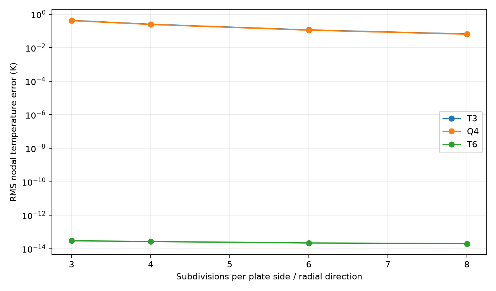
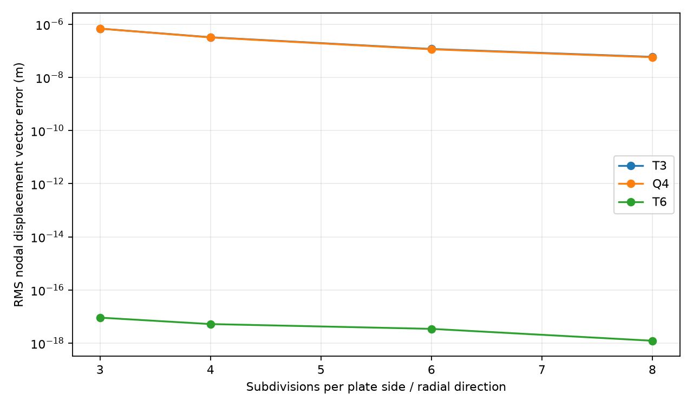
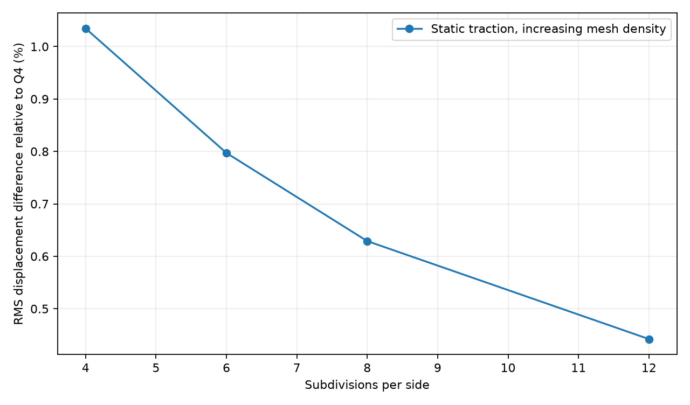
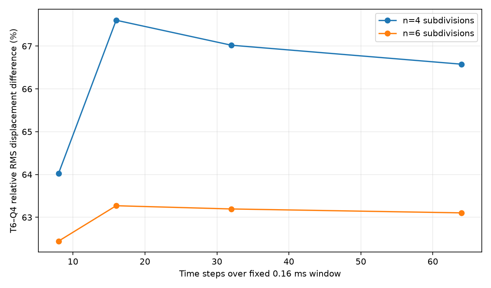

# v0.6 | Continuum-manufactured two-way transient verification

**Scope:** Synthetic, analytically forced coupled plane-stress problem on a **square plate with an eccentric rectangular through-hole**. Independently prescribed exact space–time fields are used to verify the existing T3/T6 implementation and the separate Q4 spatial reference. This is a **continuum strong-form manufactured solution**, not merely a second time integrator of the same spatial matrices. It does not use experimental or historical MATLAB data, and it is not verification by an external established FEM package.

## 1. Continuum equations and material assumptions

For a constant-property isotropic material under linear small-strain plane stress, with displacement \(\mathbf u=(u_x,u_y)\), reference temperature \(T_0\), and \(\theta=T-T_0\), the selected model is

\[
\rho\ddot{\mathbf u}-\nabla\cdot\boldsymbol\sigma=\mathbf b,\quad
\boldsymbol\sigma=\mathbf D_{ps}\boldsymbol\varepsilon-\beta\theta\mathbf I,\quad
\beta=\frac{E\alpha}{1-\nu}.
\]

\[
\rho c\dot\theta-k\nabla^2\theta+T_0\beta\nabla\cdot\dot{\mathbf u}=Q.
\]

The body force \(\mathbf b\) has units N/m³ and the volumetric heat source \(Q\) has units W/m³. The two-dimensional heat capacity is interpreted as that of the selected reduced plane-stress model (see `COUPLED_DYNAMICS.md`), not a universal 3D constant-strain/constant-stress relation. Numerical matrices multiply by the physical plate thickness.

## 2. Independently manufactured fields

The manufactured benchmark uses the following exact smooth continuum solution for \(x,y\) in metres and \(t\) in seconds:

\[
\mathbf u^*(x,y,t)=A(t+\gamma t^2)\begin{bmatrix}x^2\\xy\end{bmatrix},\qquad
\theta^*(x,y,t)=Bt(x^2+2y^2),
\]

where \(A=0.02\ \mathrm{m}^{-1}\mathrm{s}^{-1}\), \(B=6000\ \mathrm{K}\,\mathrm{m}^{-2}\mathrm{s}^{-1}\), and \(\gamma\) is either zero or \(5000\ \mathrm{s}^{-1}\). Both fields are spatially quadratic; for \(\gamma\ne0\), \(\ddot{\mathbf u}^*=2A\gamma(x^2,xy)^\mathsf T\) is nonzero.

Analytically differentiating the **continuum PDE**, rather than using the assembled FEM matrices to synthesize residual forces, gives

\[
\begin{aligned}
 b_x &= 2\rho A\gamma x^2 - A(t+\gamma t^2)\left[\frac{E}{1-\nu^2}(2+\nu)+\frac{E}{2(1+\nu)}\right] + 2\beta Bt x,\\
 b_y &= 2\rho A\gamma xy +4\beta Bt y,\\
 Q &= \rho c B(x^2+2y^2)-6kBt+3T_0\beta A(1+2\gamma t)x.
\end{aligned}
\]

These source expressions are evaluated at physical Gaussian quadrature locations independently of the production element-assembly functions. The manufactured fields specify time-dependent displacement and temperature on **every physical boundary, including the hole**. At \(t=0\), \(\mathbf u=0\), \(\theta=0\), \(\dot{\mathbf u}=A(x^2,xy)^\mathsf T\), and \(\ddot{\mathbf u}=2A\gamma(x^2,xy)^\mathsf T\). The exact initial velocity and acceleration are critical to obtaining a fair dynamic test.

**Implementation scope:** These time-varying essential conditions and analytic body-load quadratures are implemented in `manufactured.py` as a dedicated verification harness. They are **not yet general, user-selectable boundary conditions or source functions in the normal application/CLI**.

The T3/T6 matrices come from the production kernels. The Q4 matrices are assembled independently in `q4_reference.py`. The manufactured analytic source formulas and exact fields are independent of both. All three use monolithic Newmark average acceleration for mechanics and backward Euler for thermal evolution. This time integration reproduces these chosen polynomial-in-time fields exactly when they are exactly represented in space; it does not test high-frequency transient accuracy. The v0.4 DOP853 study continues to cover temporal-error trends separately.

## 3. Measured spatial convergence at the final time

Each case uses the same eccentric rectangular-hole plate, 8 steps up to \(t_f=0.001\) s, the v0.5 material parameters, and \(\gamma=0\). Errors compare computed nodal fields with exact values at the **respective element family’s nodes**, without smoothing or spatial extrapolation.

| Subdivisions | T3 temperature RMS (K) | Q4 temperature RMS (K) | T6 temperature RMS (K) | T3 displacement RMS (m) | Q4 displacement RMS (m) | T6 displacement RMS (m) |
| ---: | ---: | ---: | ---: | ---: | ---: | ---: |
| 3 | 0.421629 | 0.413653 | 2.97e-14 | 6.84e-7 | 6.80e-7 | 9.08e-18 |
| 4 | 0.248324 | 0.243335 | 2.68e-14 | 3.23e-7 | 3.17e-7 | 5.20e-18 |
| 6 | 0.113935 | 0.111225 | 2.19e-14 | 1.17e-7 | 1.13e-7 | 3.43e-18 |
| 8 | 0.065310 | 0.063682 | 2.01e-14 | 5.90e-8 | 5.72e-8 | 1.23e-18 |

Thus T3 and Q4 errors decrease under refinement, while affine-geometry T6 recovers the exactly representable quadratic fields to floating-point precision. **This near-exact T6 behavior is mathematically expected because quadratic interpolation can represent the manufactured spatial fields**; it is not proof that T6 solves arbitrary geometries, sharp-corner stresses, or abrupt-wave problems exactly.

With **\(\gamma=5000\,\mathrm{s}^{-1}\)** on the 4-subdivision mesh, T6 still yields RMS errors of approximately \(2.72\times 10^{-14}\) K and \(7.32\times10^{-18}\) m, exercising a nonzero inertial term. Turning off the thermal feedback matrix while retaining the *fully coupled* prescribed source produces an RMS temperature error of roughly **0.0074 K**, confirming that the benchmark is sensitive to the feedback term.





## 4. Diagnosing the unresolved abrupt-load comparison

The v0.5 comparison used a **sudden, constant 2 MPa traction** and inspected the response after just \(0.16\) ms. That transient contains broad-frequency elastic waves. The new manufactured benchmark instead uses smooth fields and matched exact time-varying boundary data; the two problems must not be conflated.

Two additional diagnostics were performed on the original load case with matched Q4/T6 corner vertices:

- In the **static elasticity** limit with the same 2 MPa top traction at reference temperature, the relative RMS displacement difference falls from **1.03% (4 subdivisions)** to **0.44% (12 subdivisions)**. That supports both spatial stiffness implementations for this much simpler problem.
- In the **short-time dynamic** problem at 4 subdivisions, refining the timestep from **8 to 64 steps over the same 0.16 ms** changes the relative RMS T6/Q4 difference from **64.0% to 66.6%**, rather than driving it toward zero. At 6 subdivisions, the analogous difference remains around **62–63%**.

**Interpretation:** A large discrepancy persists between low-order Q4 and higher-order T6 for the under-resolved abruptly excited transient. Reducing only the time step is not sufficient. Spatial wave dispersion, unresolved high-frequency modes, and effective initial-load regularity are plausible contributors. Their relative importance is **not yet identified**. The figures do not establish that one code is correct and the other wrong in that regime.





## 5. Reproduce

From the project root (Python 3.11+):

```bash
python -m pip install -e ".[dev]"
python -m pytest -q tests/test_manufactured_coupled.py
python examples/scripts/verify_manufactured_coupled.py
```

Generated in `results/verification/`: `coupled_manufactured_convergence.csv`, `coupled_manufactured_acceleration.csv`, `coupled_manufactured_temperature.png`, `coupled_manufactured_displacement.png`, `q4_t6_static_dynamic_diagnostics.csv`, `q4_t6_static_comparison.png`, and `q4_t6_dynamic_time_sensitivity.png`.

## 6. Remaining limits and next tests

1. Independently verify one or more **wave-transient cases** using smooth ramped tractions, controlled modal content and a high-resolution reference (preferably a separate established FEM package).
2. Test mechanical inertia and thermal coupling under a more general manufactured time dependence, so temporal integration error is nonzero and measurable.
3. Compare continuum-energy or \(H^1\)-seminorm errors, not only nodal RMS; check constraint reactions and fluxes against independent expressions.
4. Investigate hole-corner stress singularities with geometry appropriate to the physical problem, rather than interpreting raw centroid maxima as converged design stresses.
5. Extend production model configuration to time-dependent mechanical/thermal boundary conditions **only after** their formulation and validation are designed.

The original Persian coursework reports a three-field coupled T6 formulation. This release verifies the **2026 reduced plane-stress Python implementation**, not an exact transcription or independent reconstruction of the original 2016 numerical solution.
