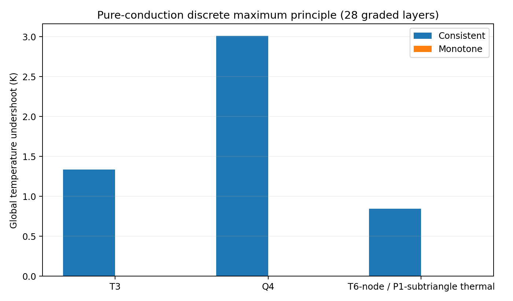
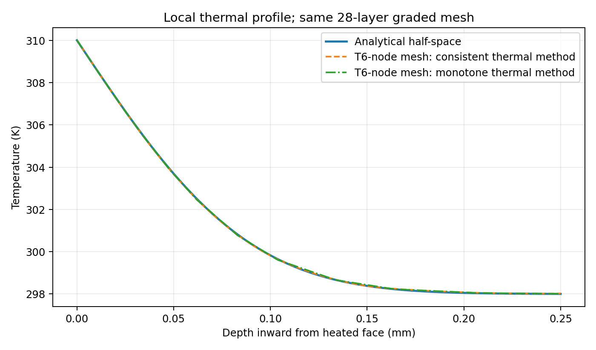
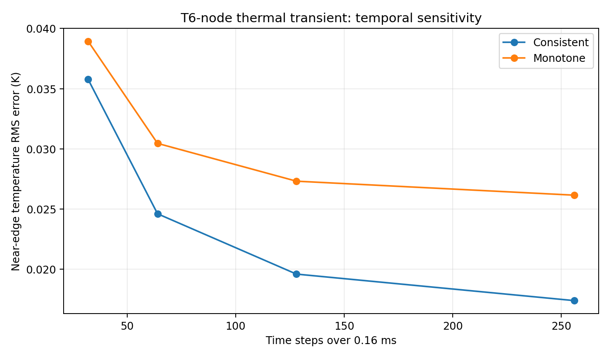
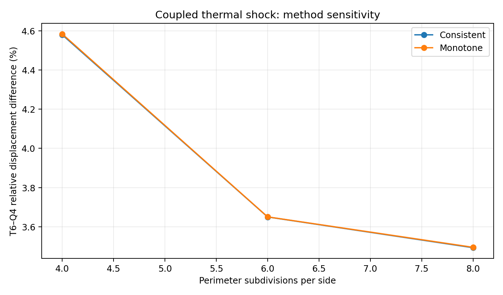

# A Monotone Thermal Reference for Early-Time Boundary-Layer Conduction

**Mehdi Soroush**  
**ThermoFEM-2D · v0.7 experimental verification · November 2026**

## Abstract

Early-time heat conduction in a perforated steel plate under a 298-to-310 K boundary-temperature step is examined with graded triangular and quadrilateral meshes. The previously used consistent thermal-capacity discretizations reproduce the one-dimensional semi-infinite temperature profile accurately near the heated face but display nonphysical undershoots elsewhere in the two-dimensional domain. A separate monotone thermal reference is introduced using positive diagonal heat capacity, symmetric graph-Laplacian diffusion correction, and, for six-node triangular meshes, a conforming piecewise-linear subtriangulation of the temperature field. At 0.16 ms, a 28-layer graded mesh with 128 backward-Euler steps yields global temperature fields within [298, 310] K for all tested element families, while preserving discrete heat balance. The stronger maximum-principle property comes at a measurable accuracy cost in local temperature profiles. The present method is a deliberately lower-order verification reference, not a replacement for the quadratic thermal formulation or an external certification of a coupled thermoelastic solution.

## 1. Governing thermal problem and admissible bounds

The verification problem is homogeneous isotropic conduction with no internal heat generation or thermoelastic feedback:

\[
\rho c\,\partial_t T - k\nabla^2 T = 0,\quad
T(\mathbf x,0)=298\;\mathrm K
\]

in a 2 m by 2 m plate with an eccentric rectangular opening. The left outer boundary is suddenly held at 310 K, the right outer boundary at 298 K, and the remaining boundaries are insulated. The plate thickness is 0.02 m, with \(k=54\;\mathrm{W/(m\,K)}\), \(\rho=7830\;\mathrm{kg/m^3}\), and \(c=452\;\mathrm{J/(kg\,K)}\). For this **uncoupled, source-free** scalar diffusion problem, the continuous maximum principle bounds the temperature by the initial and boundary extremes: \(298\le T\le310\) K.

The semi-infinite \(\operatorname{erfc}\) reference from [Thermal Shock Boundary Layer](THERMAL_SHOCK_BOUNDARY_LAYER.md) is applicable only locally around the midpoint of the heated edge at early times. It is not an analytical solution of the complete two-dimensional perforated plate.

## 2. Positivity-preserving discrete reference

The previous Galerkin conduction operator uses a consistent heat-capacity matrix \(\mathbf C\), symmetric conductivity \(\mathbf K\), and backward Euler:

\[
(\mathbf C/\Delta t+\mathbf K)\mathbf T^{n+1}
=\mathbf C\mathbf T^n/\Delta t.
\]

A consistent capacity matrix can have positive off-diagonal entries. In a severely stretched mesh it does not guarantee a discrete maximum principle, even with an implicit stepper.

The monotone verification scheme has two steps:

1. Replace \(\mathbf C\) by a **strictly positive diagonal matrix** \(\mathbf C_L\), while preserving total integrated heat capacity.
2. Let \(p_{ij}=\max(K_{ij},0)\) for \(i\ne j\), symmetrized within floating-point tolerance, and \(p_{ii}=0\). Set

\[
\boxed{\mathbf K_M=\mathbf K +\operatorname{diag}(\mathbf P\mathbf 1)-\mathbf P}.
\]

Every off-diagonal entry of \(\mathbf K_M\) is nonpositive, the matrix is symmetric, and \(\mathbf K_M\mathbf 1=0\). The added matrix is a positive-semidefinite graph Laplacian, so the correction increases numerical diffusion without adding or removing heat from a constant field. With \(\mathbf C_L\) positive diagonal, the free-node implicit matrix is a nonsingular M-matrix under the specified Dirichlet conditions. Therefore, for **this source-free heat equation**, each time step retains the prescribed initial/boundary temperature interval without post-solve clipping.

For T3 and Q4, the diagonal capacity is obtained from the row sums of the original consistent matrix. The conductivity matrix is derived from the original T3 or independent Q4 assembly, then monotonized as above.

**Quadratic T6 distinction.** Ordinary six-node triangular Lagrange vertex shape functions integrate to zero on an affine triangle. Direct row-sum capacity lumping consequently produces zero corner-node capacity and cannot yield a positive diagonal capacity. The monotone reference therefore replaces the T6 *thermal approximation* by four conforming T3 subtriangles using the same six mesh nodes. Conductivity and heat capacity are integrated over these four P1 subtriangles, with positive vertex weights, before graph correction. The field is piecewise linear on the subtriangles, **not a quadratic T6 temperature field**. The radial profile and surface gradient in the new benchmarks use the correct subsegment linear interpolation; quadratic interpolation is retained only for the existing consistent T6 scheme.

## 3. Reproducible thermal-only comparison

For 6 subdivisions per perimeter side, 28 graded radial layers (geometric growth 1.45), 128 time steps to 0.16 ms, and the full physical mesh, the results are:

| Family | Scheme | Global minimum (K) | Undershoot (K) | Left-edge profile RMS (K) | Surface heat-flux error | Boundary energy input (J) |
|:--|:--|--:|--:|--:|--:|--:|
| T3 | Consistent | 296.66676 | 1.33324 | 0.08527 | 0.743% | 96.020 |
| T3 | Monotone | 298.00000 | 0.00000 | 0.09491 | 0.826% | 99.509 |
| Q4 | Consistent | 294.98920 | 3.01080 | 0.08200 | 0.585% | 92.551 |
| Q4 | Monotone | 298.00000 | 0.00000 | 0.09467 | 1.539% | 118.811 |
| T6-node mesh | Consistent quadratic | 297.15578 | 0.84422 | 0.01958 | 0.760% | 95.222 |
| T6-node mesh | Monotone P1 subtriangles | 298.00000 | 0.00000 | 0.02730 | 0.429% | 96.887 |

All compared runs stay below the prescribed 310 K maximum. The monotone thermal fields remain within the admissible interval **at all time steps**, not merely at the final time. Quantities are computed from the generated CSV and the solver state without data smoothing or nodal clipping.







The sharper consistent T6 thermal solution retains better near-edge temperature accuracy but has an unphysical remote undershoot. The monotone P1-subtriangle thermal reference eliminates that undershoot while modestly increasing the local profile error. The Q4 monotone formulation exhibits a larger difference in total boundary heat input than the original Q4 method; it is a **distinct diffusive numerical approximation**, not an exact replacement. Refinement and an independent high-resolution heat-transfer reference remain necessary before quantitative thermal-load certification.

## 4. Heat balance

The boundary reaction associated with a fixed-temperature node is evaluated from the full transient residual after solving each step:

\[
\mathbf r^n=\mathbf C\frac{\mathbf T^{n+1}-\mathbf T^n}{\Delta t}
+\mathbf K\mathbf T^{n+1}.
\]

The free-node residual vanishes numerically. Because each conduction operator has zero row sum, cumulative heat supplied by the prescribed-temperature boundary equals the net increase in discrete sensible heat:

\[
\sum_n\Delta t\sum_{i\in\Gamma_D}r_i^n
=\mathbf1^\mathsf T\mathbf C(\mathbf T^N-\mathbf T^0).
\]

Here the initial discrete state includes the imposed temperature at essential boundary nodes at \(t=0^+\); the equality audits the subsequent finite-element transient. It is a **discrete conservation identity**, not an independently measured physical heat-input rate. All six compared cases exhibit absolute energy mismatch below \(5\times10^{-13}\) J in the reference run. This verifies matrix accounting and boundary reactions, but does not by itself guarantee accuracy relative to continuum heat transfer.

## 5. Coupled thermoelastic comparison and its limitation

The modified T6-node reference retains a quadratic displacement field but uses a piecewise-linear thermal field on the four subtriangles. Its coupling matrix is integrated with the **same P1 thermal interpolation** and the parent T6 mechanical strain interpolation; the reciprocal thermal feedback matrix remains \(T_0\mathbf G^\mathsf T\). The original high-order T6 thermal coupling has not been silently reused as though the thermal interpolation were unchanged.

| Perimeter subdivisions | Radial layers | Steps | Q4–T6 relative displacement difference: consistent | Monotone thermal reference |
|--:|--:|--:|--:|--:|
| 4 | 22 | 32 | 4.580% | 4.584% |
| 6 | 28 | 64 | 3.650% | 3.650% |
| 8 | 28 | 64 | 3.493% | 3.495% |



The modified and original thermal schemes yield similar *relative* Q4–T6 displacement differences under the present graded-mesh conditions. This does **not** establish absolute coupled accuracy. In a fully coupled thermoelastic equation, the deformation-rate term \(T_0\mathbf G^\mathsf T\dot{\mathbf u}\) may act as a heat source or sink. Consequently, the uncoupled heat-equation maximum principle does not impose a universal \(T\ge298\) K bound on a coupled deformation problem. Temperatures below 298 K in the coupled runs must be assessed using thermoelastic energy and physical convergence checks; they must not be automatically clipped or automatically categorized as numerical undershoots.

## 6. Verification status, reproducibility and publication hold

Run from the project root with Python 3.11 or newer:

```bash
python -m pip install -e ".[dev]"
python -m pytest -q
python examples/scripts/verify_monotone_thermal.py
```

The reproduction script writes three CSV tables, one JSON provenance record, and four PNG figures under `results/verification/`. The corresponding regression tests cover temperature bounds, thermal energy balance, exact affine coupling, and analytical near-boundary profiles. The optional Streamlit interface is exercised by a separate CI smoke test.

This study demonstrates a **conservative, bound-preserving thermal-only reference** and confirms the trade-off between monotonicity and high-order accuracy. Outstanding scientific validation requirements include:

- an external or independently highly resolved full-domain transient conduction reference, including quantitative global error norms and boundary heat input;
- an independently verified coupled thermoelastic energy budget and mesh/time-converged displacement/stress measures;
- mesh-quality checks for highly anisotropic elements, and a higher-order bound-preserving method if quadratic temperature accuracy is required;

**Scope restriction:** This method is an experimental thermal-only verification reference, not a replacement for the production high-order thermal solver. Numerical outputs are not independently certified design stresses or experimentally validated material responses.
