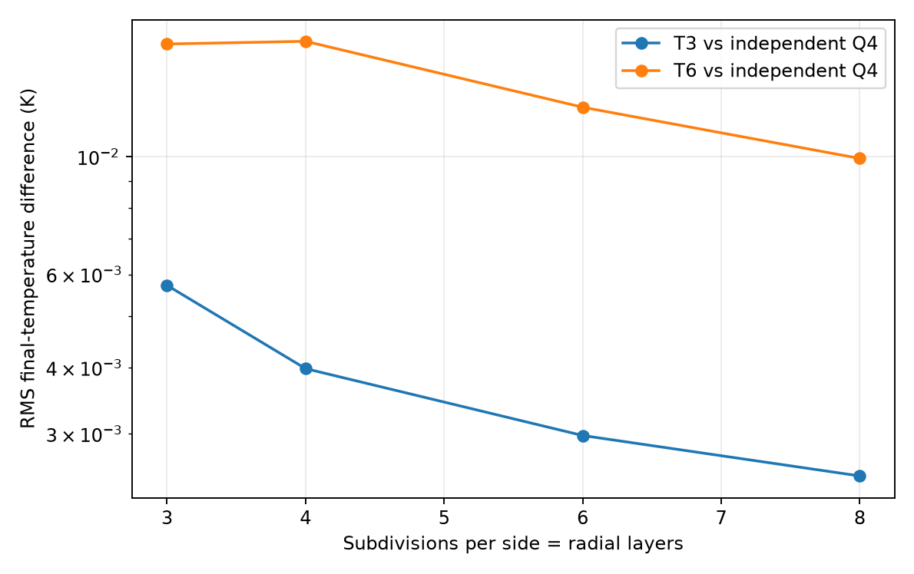
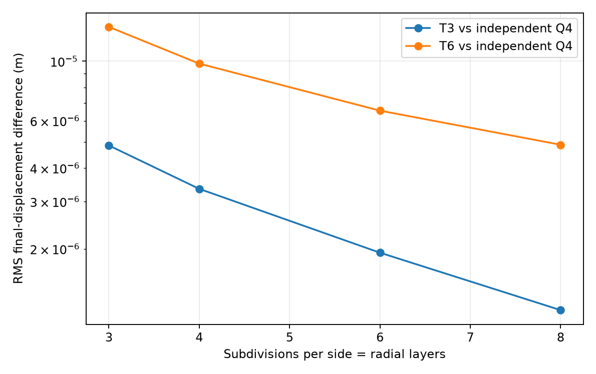

# Independent Q4 spatial reference — v0.5.0

## Scope of evidence

This release introduces a **separate, independently assembled bilinear Q4 quadrilateral finite-element implementation** of the same constant-coefficient, small-strain, plane-stress, two-way thermoelastic model. The reference is intentionally separated from the triangular solver and does **not** import its geometry, shape functions, quadrature, element matrices, boundary assembly, coupled stepper, or time-integration functions.

The independent program in `src/thermofem2d/q4_reference.py` provides:

- A conforming, four-node quadrilateral mesh of a rectangular plate with one rectangular hole (including eccentric holes).
- Natural-coordinate bilinear interpolation and full 2×2 Gauss integration, with Jacobian-sign checks.
- Independently assembled conductivity `K_T`, consistent thermal capacity `C_T`, plane-stress stiffness `K_u`, consistent inertia `M_u`, and reciprocal thermoelastic coupling `G`.
- Constant boundary temperature, heat-flux, traction, and displacement conditions; zero initial displacement and velocity; uniform or affine initial temperature.
- A separately coded Newmark average-acceleration/backward-Euler monolithic solve of the **same** reduced coupled equations.

**The Q4 solver is a reference/test harness, not yet a selectable element family in the Streamlit production interface.** Its spatial discretization and matrix assembly are independent, but it implements the same physical assumptions and broadly the same temporal scheme. It is **not** an external commercial package comparison or validation against the original 2016 MATLAB numerical outputs.

## Independent element formulation

For nodal positions ordered counterclockwise on the reference square `(ξ,η) ∈ [-1,1]²`, the shape functions are

\[
 N_i(\xi,\eta)=\frac14(1+\xi_i\xi)(1+\eta_i\eta),
 \qquad (\xi_i,\eta_i)\in\{(-1,-1),(1,-1),(1,1),(-1,1)\}.
\]

Physical derivatives follow `∇_x N = ∇_{ξ} N J^{-1}` with `J = ∂(x,y)/∂(ξ,η)` and `det(J)>0` at each integration point. All element integrals use the tensor-product 2×2 Gauss rule; no triangle integration routine is reused. For plate thickness `h`, conductivity `k`, density `ρ`, heat capacity `c`, plane-stress elasticity tensor `D`, and thermal-expansion vector `a = α[1,1,0]ᵀ`:

\[
K_T^e=\int_{\Omega_e}h k\, (\nabla N)^T (\nabla N)\,dA,
\quad C_T^e=\int_{\Omega_e}h\rho c\,N^TN\,dA,
\]

\[
K_u^e=\int_{\Omega_e}hB^TDB\,dA,\quad
M_u^e=\int_{\Omega_e}h\rho N_u^TN_u\,dA,\quad
G^e=\int_{\Omega_e}h B^TDa N\,dA.
\]

The assembled reference system advances

\[
M_u\ddot u+K_uu-G\theta=f,\qquad
C_T\dot\theta+K_T\theta+T_{ref}G^T\dot u=q.
\]

This plane-stress reduction, constant-property assumption, and heat-capacity interpretation match the production solver; they are not claimed to replicate the exact original 2016 three-dimensional source formulation.

## Analytical patch tests and mesh quality

An affine harmonic temperature field `T=310+8x−3y` K with its exact values prescribed on **all physical boundaries**, including the hole, must be recovered by the source-free Q4 diffusion problem. Likewise, an affine two-component displacement field with constant strain must satisfy the source-free interior mechanical equilibrium equations when that displacement is imposed on all physical boundary nodes.

For the eccentric-hole mesh (2×2 m plate; 0.24×0.20 m hole, centered at x=0.12 m, y=−0.08 m), the maximum absolute nodal errors were:

| Subdivisions per side/radial | Q4 elements | Thermal patch error (K) | Mechanical patch error (m) |
| ---: | ---: | ---: | ---: |
| 3 | 36 | 1.71e−13 | 1.02e−20 |
| 4 | 64 | 1.71e−13 | 1.36e−20 |
| 6 | 144 | 5.68e−13 | 1.69e−20 |
| 8 | 256 | 6.25e−13 | 5.08e−20 |

Additional tests verify the material area against outer minus hole area, positive Gauss-point Jacobians, symmetric stiffness and mass matrices (within floating-point tolerance), positive-definite consistent mass/capacity matrices, and vanishing thermal coupling for rigid translation. These are consistency checks, not a complete verification of arbitrary geometry or dynamic solutions.

## Dynamic spatial comparison with independently assembled Q4

Both implementations are run at the **same** time grid: 8 steps of 2×10⁻⁵ s, with the same initial and boundary data from `examples/coupled_plate_t6.json`. Both have a temperature of 310 K at the left edge, 298 K at the right edge, zero horizontal displacement on the left edge, zero vertical displacement on the bottom edge, and a 2 MPa upward traction at the top edge. Geometry and material parameters are fixed. The Q4 solver is compared against separate T3 and T6 runs.

The Q4 and triangular mesh generators produce **the same spatial coordinates at the shared corner vertices**. Thus differences in the computed final temperature and displacement are evaluated at physically corresponding nodes, without nearest-neighbor extrapolation to unrelated coordinates. T6 midside nodes are **not** included in these comparisons. The RMS displacement difference is defined as the root-mean-square Euclidean 2D vector difference; the reported relative difference divides by the Q4 RMS displacement *vector magnitude* across the shared vertices.

| Subdivisions | T3–Q4 temperature RMS (K) | T6–Q4 temperature RMS (K) | T3–Q4 displacement RMS (µm) | T6–Q4 displacement RMS (µm) |
| ---: | ---: | ---: | ---: | ---: |
| 3 | 0.005720 | 0.016326 | 4.855 | 13.422 |
| 4 | 0.003983 | 0.016518 | 3.347 | 9.798 |
| 6 | 0.002979 | 0.012403 | 1.936 | 6.546 |
| 8 | 0.002499 | 0.009930 | 1.184 | 4.886 |

The **T3–Q4** differences decrease across these four refinement levels. T6–Q4 temperature difference is not strictly monotone at the first refinement; it subsequently decreases. The T6–Q4 *relative* displacement difference at the finest investigated level remains approximately **60.4% of the Q4 RMS displacement magnitude**, much too large to call the spatial results mutually converged. The T3–Q4 relative displacement difference at that level remains approximately **14.6%**.

These differences may reflect approximation order, inertia/dispersion, finite mesh resolution, discretization effects and implementation differences. The present evidence **does not determine which spatial solver is closer to the continuum solution**. This is a numerical consistency benchmark and a transparent identified limitation, **not** a declaration that the fully coupled model has been independently physically validated.





## Reproduction and remaining work

```bash
python -m pip install -e ".[dev]"
python -m pytest -q
python examples/scripts/verify_q4_spatial.py
```

Output files:

- `results/verification/q4_patch_tests.csv` — analytical patch-test results.
- `results/verification/q4_spatial_comparison.csv` — matched-vertex T3/T6–Q4 differences.
- `results/verification/q4_temperature_comparison.png` — spatial temperature-difference curves.
- `results/verification/q4_displacement_comparison.png` — spatial displacement-difference curves.

Next steps for a stronger continuum-level validation include a shared smooth manufactured solution of the *full* transient PDE (including mechanically consistent sources), extension to larger spatial resolutions and time-step convergence at each resolution, energy-norm comparisons, comparison with an established independent FE package, and careful handling of stresses near the sharp hole corners. In the current results, local peak stresses remain **unconverged** and cannot be used as design acceptance values.

**Formulation references (background, not independent test results):** [Introduction to Finite Element Methods — Q4 isoparametric element](https://vulcanhammer.net/wp-content/uploads/2017/01/ifem.pdf), and [Quadrilateral element integration discussion](https://help.geostru.eu/gfas/en/numericalintegrationinfiniteelements.htm).
