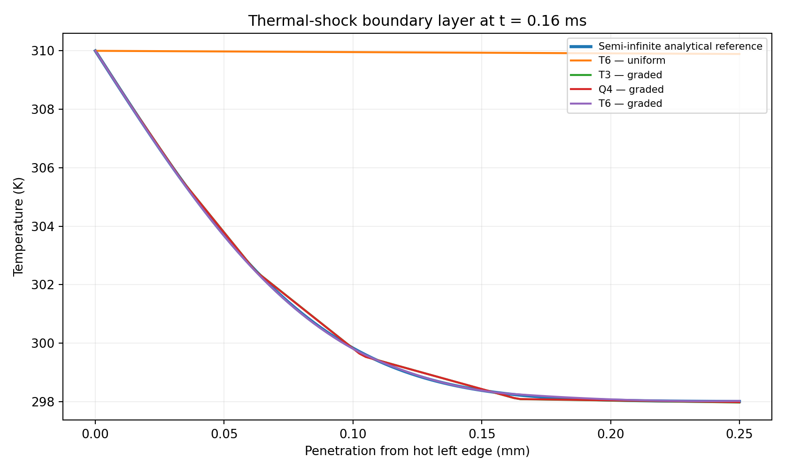
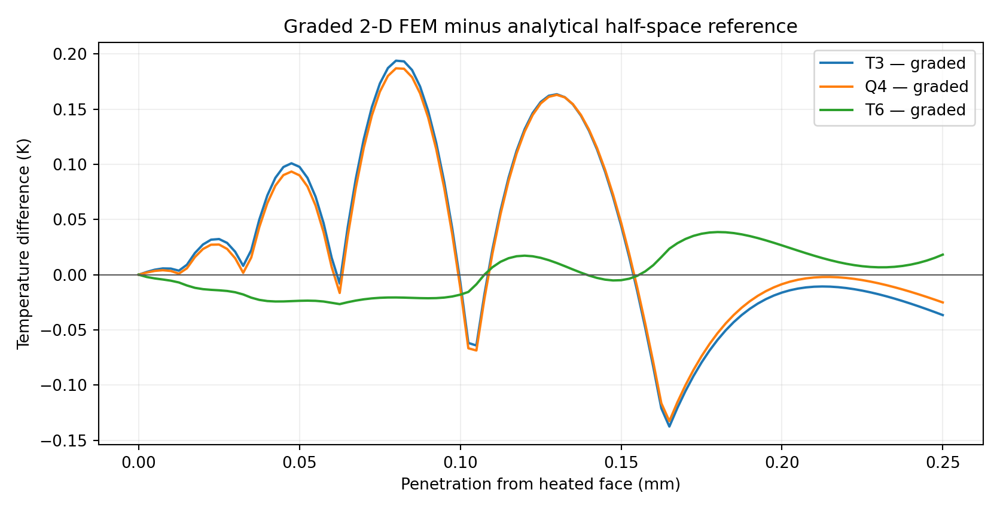
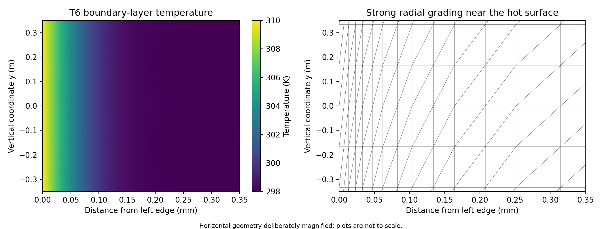
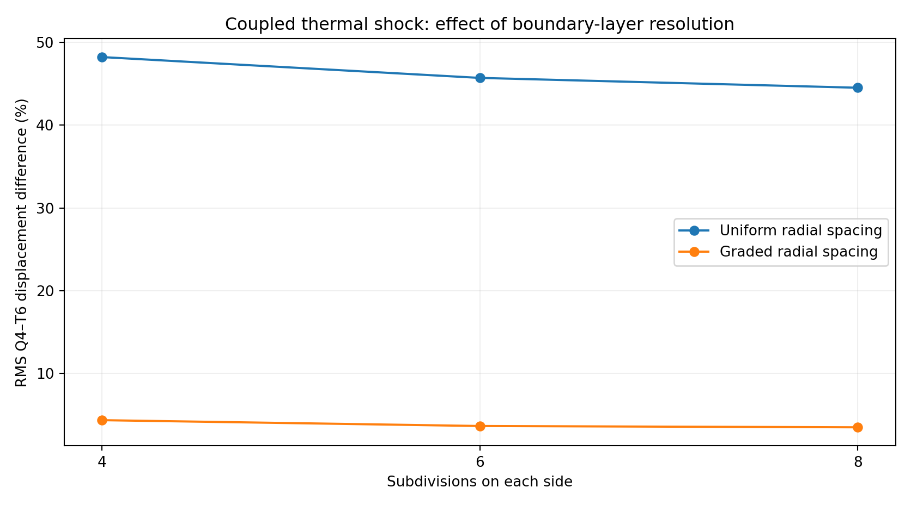

# Early-Time Thermal-Shock Resolution in a Perforated Plate

**Mehdi Soroush** · Computational Solid Mechanics · November 2026  
**ThermoFEM-2D v0.7 verification extension** · Experimental numerical benchmark

## Abstract

A short-time two-way coupled transient on a perforated plate previously produced a 63–67% displacement-field difference between independently assembled Q4 and T6 discretizations on coarse meshes. Controlled v0.7 investigations isolated the instantaneous thermal boundary step as the primary source of disagreement. The present study measures the thermal-layer resolution directly against an analytical semi-infinite conduction solution, introduces geometry-fitted radial grading for T3, Q4, and T6, and re-evaluates the coupled displacement comparison using the same mechanical and thermal loading. At 0.16 ms, the characteristic thermal diffusion length is 0.0494 mm, while the 1% penetration distance is 0.1800 mm. With 28 graded radial layers (13.64 µm first spacing), the temperature profile at the middle of the heated edge agrees with the analytical solution to 0.0853 K RMS for T3, 0.0820 K for Q4, and 0.0196 K for T6. The coupled Q4–T6 displacement discrepancy falls from 44–48% with 28 **uniform** radial layers to 3.49–4.36% with the same number of **graded** radial layers across three circumferential resolutions. The graded FE solutions, however, exhibit nonphysical undershoots elsewhere in the full two-dimensional domain, reaching approximately 3.0 K below the initial temperature for Q4. **Local boundary-layer agreement does not establish globally reliable transient temperature or stress predictions.** These findings warrant further work on mesh quality, monotone heat discretization, energy balance, and independent coupled-reference convergence before release.

## 1. Physical problem and evidence classification

The benchmark is a 2 m × 2 m isotropic steel plate with an eccentric 0.24 m × 0.20 m rectangular through-hole centred at (0.12, −0.08) m. Its thickness is 0.02 m. The material values are:

| Quantity | Value |
| --- | ---: |
| Young's modulus, E | 200 GPa |
| Poisson ratio, ν | 0.30 |
| Density, ρ | 7830 kg/m³ |
| Conductivity, k | 54 W/(m K) |
| Specific heat, c | 452 J/(kg K) |
| Expansion coefficient, α | 11.7 × 10⁻⁶ K⁻¹ |
| Reference temperature, T₀ | 298 K |

For thermal-only reference simulations, the plate is initially at 298 K, with the left outer edge set to 310 K at the start of the transient and the right outer edge held at 298 K. The remaining boundaries are insulated. The thermal-only simulation excludes mechanical coupling, allowing a direct comparison to the analytically solved heat equation. The coupled diagnostic additionally imposes a sudden top traction of 2 MPa in the positive vertical direction, `u_x=0` on the left edge, `u_y=0` on the bottom edge, and two-way temperature–deformation feedback. The time horizon is 0.16 ms.

**Independent ingredients:** The half-space solution derives from the one-dimensional continuum heat equation; the Q4 and T3/T6 models use different numerical shape functions and assembly routines. The coupled Q4/T6 comparison shares the same Newmark/backward-Euler integration framework. It is an internal cross-discretization result, not an Abaqus validation or an independently exact full-domain thermoelastic solution.

## 2. Analytical thermal-shock reference

With the half-space coordinate \(d\geq0\) measured inward from the heated face, constant properties, and a suddenly applied constant surface temperature \(T_s\), the exact one-dimensional temperature field is

\[
T_{1D}(d,t)=T_0+(T_s-T_0)\operatorname{erfc}\left(\frac{d}{2\sqrt{\kappa t}}\right),
\qquad \kappa=\frac{k}{\rho c}.
\]

The initial condition is \(T(d,0)=T_0\) for \(d>0\); the surface temperature is imposed for \(t>0\). At the face, the exact inward conductive heat flux is

\[
q_s''=\frac{k(T_s-T_0)}{\sqrt{\pi\kappa t}}.
\]

For the selected material at \(t=1.60\times10^{-4}\,\mathrm{s}\),

\[
\kappa=1.5257858\times10^{-5}\,\mathrm{m^2/s},\qquad
\sqrt{\kappa t}=0.04941\,\mathrm{mm},
\]

\[
d_{1\%}=2\operatorname{erfc}^{-1}(0.01)\sqrt{\kappa t}
=0.179986\,\mathrm{mm},\quad
q_s''=7.39935\,\mathrm{MW/m^2}.
\]

This exact solution is a **local early-time benchmark** near the middle of the outer left edge, where the thermal penetration depth is negligible compared with the distance to the hole and other boundaries. It does **not** solve the actual finite two-dimensional holed geometry, and it does not validate elastic stresses. The formula is standard in semi-infinite transient heat conduction; see *Process Heat Transfer*, section on the semi-infinite solid (https://www.sciencedirect.com/book/monograph/9780123971951/process-heat-transfer).

## 3. Geometry-conforming boundary-layer refinement

Each mesh retains the original concentric perimeter-to-perimeter topology. Interior ring \(j=0\) lies on the hole, and outer ring \(j=n_r\) lies on the plate perimeter. For layer ratio \(r>1\), the normalized inner-to-outer ring locations are

\[
t_j=1-\frac{r^{n_r-j}-1}{r^{n_r}-1},\qquad j=0,\ldots,n_r.
\]

This concentrates radial subdivisions near the *entire* outer perimeter. T6 midpoint nodes are inserted after moving the T3 parent vertices; Q4 vertices are generated separately by the independent quadrilateral mesh generator and then graded using the same prescribed geometric locations. T6 edges remain straight, and parent-element connectivity is preserved.

With \(n_r=28\), \(r=1.45\), and six subdivisions on each perimeter side, the first six layers inward from the midpoint of the heated left face have thicknesses approximately 13.64, 19.78, 28.69, 41.59, 60.31, and 87.45 µm. Five interior ring vertices lie within the 0.180 mm penetration depth, plus the surface vertex. The original 12-layer uniform mesh had an approximately **83.33 mm** first element in this direction.

**Limitation of this particular grading strategy:** Global outer-ring grading creates highly anisotropic elements on unheated edges too. It is therefore intended only as a controlled verification experiment. A production mesher will require quality-aware *localized* grading, boundary-layer meshing checks, and possibly alternative transient heat schemes to avoid nonphysical field values.

## 4. Temperature and heat-flux verification

The transient heat equation is assembled with existing **consistent thermal capacity** matrices and stepped with implicit backward Euler. The left edge is prescribed at 310 K beginning at \(t=0^+\); initial interior nodes remain at 298 K. The thermal-only comparisons use 128 time steps of 1.25 µs. The continuous T6 temperature trace is evaluated with quadratic Lagrange interpolation along the radial mesh edge, rather than interpolating between T6 corner nodes linearly. The RMS metric samples 101 equally spaced physical distances in [0, 0.25] mm from the left edge, excluding the hole and remote boundaries.

| Element | Uniform 12-layer RMS | Uniform 28-layer RMS | Graded 28-layer RMS | Graded flux error | Graded global minimum |
| --- | ---: | ---: | ---: | ---: | ---: |
| T3 | 9.89596 K | 9.86916 K | 0.08527 K | 0.743% | 296.67 K |
| Q4 | 9.89596 K | 9.86916 K | 0.08200 K | 0.585% | 294.99 K |
| T6 | 9.85585 K | 9.77589 K | 0.01958 K | 0.760% | 297.16 K |

The same-28-layer uniform-versus-graded comparisons isolate the effect of radial node placement at an unchanged number of elements and nodes. Simply increasing the uniform radial mesh from 12 to 28 layers does not resolve the 0.180 mm thermal penetration region.

The maximum imposed temperature in these runs is 310 K. Consequently, all three graded-mesh solutions violate the physical minimum principle \(T\geq298\,\mathrm K\) at some locations in the full plate, even while the **local left-face profile** closely matches the exact half-space solution. Negative excursions are not interpreted as physical cooling; they are numerical artifacts, plausibly associated with consistent-capacity matrices combined with severely stretched elements. The precise mechanism and a remedy have **not** been established by this test.







### Spatial and temporal sensitivity

At 128 time steps and growth factor 1.45, increasing the radial count from 22 to 28 to 32 reduces the local RMS temperature error:

| Element | 22 layers | 28 layers | 32 layers |
| --- | ---: | ---: | ---: |
| T3 | 1.61028 K | 0.08527 K | 0.04873 K |
| Q4 | 1.60789 K | 0.08200 K | 0.04632 K |
| T6 | 0.12266 K | 0.01958 K | 0.01555 K |

The first-element width also changes with the layer count (126.83, 13.64, and 3.09 µm, respectively). Thus these are refinement comparisons with strong changes in the local spacing, **not** constant-shape uniform \(h\)-refinement or formal convergence-order estimates.

On the 28-layer T6 mesh, increasing the number of time steps from 32 to 64 to 128 to 256 changes the local RMS error from 0.03577 to 0.02459 to 0.01958 to 0.01737 K. The error approaches a nonzero spatial floor, as expected. The heat-flux error at 128 steps is 0.760%; it is based on the derivative of the interpolated temperature field at the face.

## 5. Re-evaluation of two-way coupled thermal shock

The v0.7 verification harness was extended to assemble independent Q4 and T6 mechanical, thermal, inertial, and coupling matrices **on each graded mesh**, retaining the same 2 MPa instantaneous top traction, 310 K/298 K left/right edge temperatures, reference-temperature interior initialization, 0.16 ms final time, and 64 steps. Q4–T6 displacement comparisons use shared Q4 vertex coordinates and the RMS normalization defined in `DYNAMIC_WAVE_VALIDATION.md`. The number of radial layers is held fixed at 28 for both mesh styles.

| Subdivisions along each side | Uniform radial layers | Graded radial layers | Graded absolute RMS difference |
| ---: | ---: | ---: | ---: |
| 4 | 48.23% | 4.36% | 0.1794 µm |
| 6 | 45.71% | 3.65% | 0.1487 µm |
| 8 | 44.52% | 3.49% | 0.1417 µm |

The Q4 RMS displacement in the six-subdivision graded case is approximately 4.075 µm. Comparisons at 6 subdivisions and 28 radial layers using 64 and 128 time steps give approximately 3.650% and 3.664% relative differences, respectively, so halving the time step does not significantly change the result. At six subdivisions and growth 1.45, increasing the number of radial layers from 22 to 28 to 32 yields relative differences of approximately 3.93%, 3.65%, and 3.52% at 64 steps. The remaining nonzero difference is not yet a validated continuum error estimate.



The data directly support the hypothesis that an unresolved thermal boundary layer dominated the large difference in the coarse early-time model. A substantial reduction in **cross-formulation discrepancy is not proof of physically accurate stress or displacement everywhere**, especially when both formulations retain remote unphysical temperature undershoots and share the same Newmark/backward-Euler treatment.

## 6. Reproduction and files

From a project checkout with Python 3.11 or newer and the development dependencies installed:

```bash
python -m pip install -e ".[dev]"
python -m pytest -q
python examples/scripts/verify_thermal_shock_boundary_layer.py
```

The reproducible verification produces five CSV datasets and a JSON summary in `results/verification/`, together with temperature profiles, profile error, mesh-resolution summaries, a coupled displacement comparison, and the local heat-map/mesh visualization. Test names identify separately the analytical reference, the graded topology, the T3/Q4/T6 temperature comparisons, and the fully coupled cross-discretization regression.

## 7. Remaining scientific and publication gates

1. **Resolve full-domain coupled temperature convergence.** The separate monotone pure-conduction scheme removes uncoupled undershoots, but the consistent scheme still permits overshoot/undershoot and the coupled problem has genuine strain-rate thermal sources or sinks. Investigate local mesh grading, temperature positivity and coupled-field error norms.
2. **Independently validate a spatially resolved coupled transient.** Compare with an established numerical package or an additional separately constructed fine reference with appropriately monitored gradient and displacement errors, not just Q4–T6 mutual agreement.
3. **Add path-based displacement, strain, thermal flux, and mechanical energy benchmarks**, reporting physical observation locations and reference error norms. Nonconvergent stress maxima at hole corners are not valid design metrics.
4. **Verify a general initial/boundary condition interface** before exposing thermal shocks and graded meshes as routine end-user options.
5. **Expand independent execution evidence** across Windows/Linux and run the optional Streamlit smoke tests; external coupled-shock FEM benchmarking remains an open validation objective.

**Conclusion:** The local analytical reference and graded-mesh coupled comparison substantially explain the short-time Q4–T6 discrepancy. The result is a successful **diagnostic verification study**, but **an experimental verification capability—not a globally verified thermal-shock solver or design-ready numerical release**.
